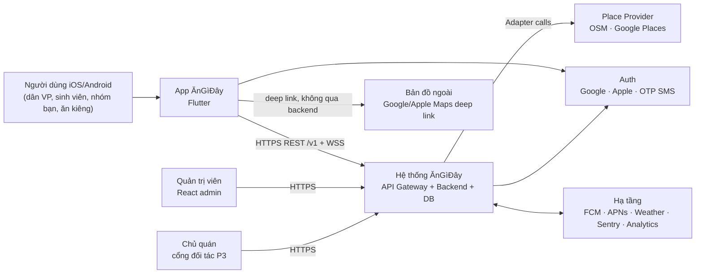
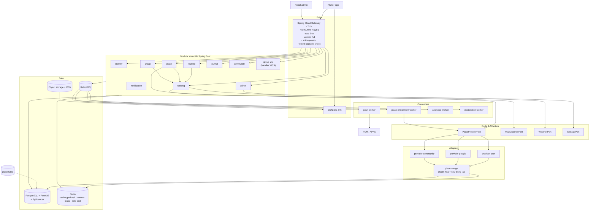
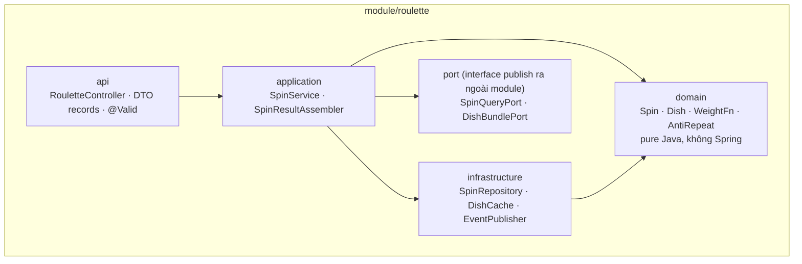
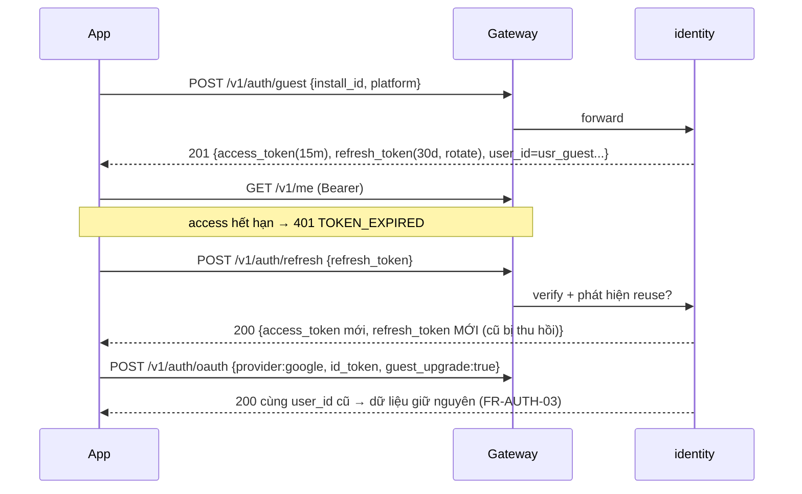
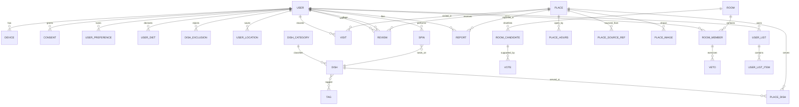
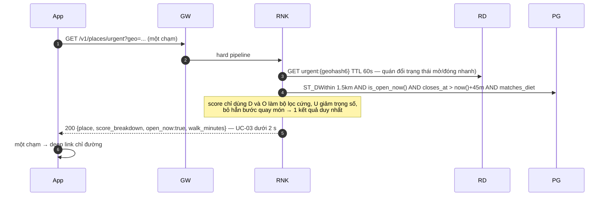
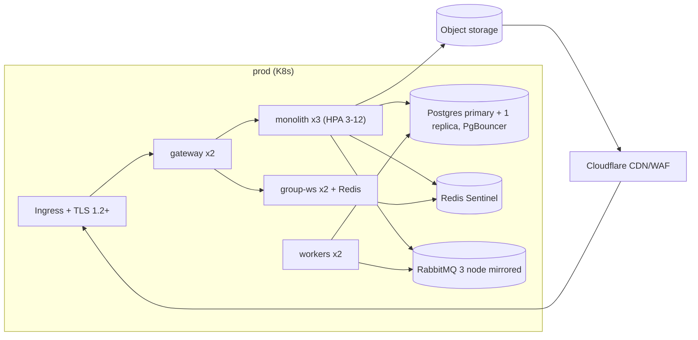

# 01 · Kiến trúc hệ thống ĂnGìĐây

*Tài liệu thiết kế hệ thống, derived từ `ĂnGìĐây – Tài liệu đặc tả yêu cầu phần mềm (SRS).md` v1.0 · phiên bản thiết kế 1.0 · 01/11/2026*

> Đọc kèm: [`02-api-dac-ta.md`](./02-api-dac-ta.md) (P1) · [`03-api-p2-p3.md`](./03-api-p2-p3.md) (P2/P3) · [`04-kich-ban-test.md`](./04-kich-ban-test.md)

---

## 1. Quyết định công nghệ (đã chốt)

| Lớp | Lựa chọn | Lý do / ghi chú |
| --- | --- | --- |
| Mobile | **Flutter 3.x** (iOS 15+, Android 8/API 26+) | Một codebase, hoạt ảnh vòng quay mượt (FR-ROU-08), `Drift`/SQLite cho kho món ngoại tuyến (FR-ROU-10) |
| Admin web | **React + TypeScript + Vite** | SRS mục 2.3 chỉ yêu cầu "trình duyệt hiện đại" |
| Backend | **Java 21 + Spring Boot 3.3**, modular monolith nhiều module Gradle | SRS mục 9: "khối mô-đun trước, tách dịch vụ sau" |
| Realtime | **Spring WebSocket (raw WSS) + Redis Streams** | FR-GRP-06 < 2s, chịu mất kết nối và vào lại phòng |
| DB chính | **PostgreSQL 16 + PostGIS 3.4 + pg_trgm** | FR-PLC-02 bán kính, mục 9 "tìm kiếm văn bản trong PostgreSQL" |
| Cache / phòng | **Redis 7** (cache geohash, rate limit, state phòng, distributed lock) | NFR-01 p95 < 500 ms khi cache trúng, NFR-05 5.000 phòng đồng thời |
| Queue / event | **RabbitMQ** (Spring AMQP) + Outbox pattern | Làm giàu dữ liệu, thông báo, phân tích; NFR-06 thành phần phụ không làm sập luồng chính |
| Object storage | **S3-compatible + CDN** (Cloudflare R2/AWS S3+CloudFront) | Ảnh món/quán, FR-PLC-05 |
| Ảnh | **OSM (Overpass + Nominatim) làm nền + Google Places/Maps Distance Matrix bổ sung**, sau đó là nguồn cộng đồng | SRS 2.6.5 cắm-rút-được; mục 9 Ports & Adapters |
| Auth | Google Identity, Apple Sign In, OTP (Twilio), JWT RS256 | FR-AUTH-02 |
| Push | FCM + APNs qua module `notification` | SRS mục 7 |
| Observability | OpenTelemetry → Prometheus/Grafana/Loki/Tempo, Sentry cho app | NFR-13 |
| CI/CD | GitHub Actions + Docker + Kubernetes (hoặc ECS) + Terraform | NFR-12 |

**Quy ước đặt tên trong toàn bộ tài liệu**: `snake_case` cho field JSON, ngày giờ `RFC3339 UTC` (`2026-11-01T03:20:00Z`), toạ độ WGS84 6 chữ số thập phân, tiền tệ **số nguyên VND** (`price_vnd: 45000`), ID dạng prefix + ULID (`ds_01J..., plc_01J..., spn_01J..., rom_01J...`).

---

## 2. Sơ đồ ngữ cảnh (C4 – Level 1)



**Điểm quan trọng khi code**: chỉ đường (FR-NAV-01) là **deep link từ app thẳng ra Google/Apple Maps**, backend không tính đường đi. Backend chỉ cung cấp toạ độ + (P2) thời gian di chuyển ước tính qua `GET /v1/routes/estimate` khi cần hiển thị trong danh sách (FR-NAV-03).

---

## 3. Sơ đồ thành phần (C4 – Level 2)



### 3.1 Bên trong một module (chuẩn cho mọi module)



**Quy tắc chặn bằng ArchUnit (NFR-12)**
1. `domain` không được phụ thuộc Spring/Jackson/JDBC.
2. Module chỉ gọi nhau qua `port`, **cấm** import `com.angi.day.<khác>.internal..`.
3. Controller không được chạm `repository`.
4. Không có dependency vòng giữa module; thứ tự hợp lệ: `common` ← `identity` ← (roulette, place, journal) ← ranking ← group ← community ← admin.

### 3.2 Cây thư mục backend

```
backend/
├─ settings.gradle.kts            # include(":apps:gateway", ":apps:monolith", ":modules:identity", ...)
├─ gradle/libs.versions.toml      # bản pin Java 21, Boot 3.3, Testcontainers
├─ libs/
│  ├─ common-api/                 # ErrorEnvelope, CursorPage, Money, GeoPoint, Headers
│  ├─ common-domain/              # Id (ULID), Clock port, CSPRNG port
│  ├─ common-persistence/         # Flyway config, PostGIS dialect, pg_trgm
│  └─ common-test/                # ArchUnit rules, ContainerFactory, JsonAssert
├─ modules/
│  ├─ identity/  roulette/  place/  ranking/  group/
│  ├─ journal/   community/ admin/  notification/
├─ ports/
│  ├─ place-provider-api/         # PlaceProviderPort, ProviderContext, PlaceCandidate
│  ├─ map-distance-api/ weather-api/ storage-api/ push-api/
├─ adapters/
│  ├─ provider-osm/               # Overpass + Nominatim, Nominatim usage policy
│  ├─ provider-google/            # Places API (New), Distance Matrix, caches
│  ├─ provider-community/         # source = user-submitted + verified
│  ├─ distance-google/
│  ├─ weather-openmeteo/
│  └─ storage-s3/
├─ apps/
│  ├─ gateway/                    # Spring Cloud Gateway (routes, JWT, Redis rate limiter)
│  ├─ monolith/                   # @SpringBootApplication, wire các module, Flyway, OpenAPI
│  ├─ group-ws/                   # WSS handler (có thể chạy thành 1 deployment riêng)
│  └─ workers/                    # enrichment, push, analytics, moderation
└─ db/migration/                  # V1__baseline.sql, V2__postgis.sql ...
```

### 3.3 Cây thư mục Flutter

```
app_flutter/
├─ pubspec.yaml
├─ lib/
│  ├─ main.dart  bootstrap.dart          # DI (get_it), error boundary
│  ├─ core/
│  │  ├─ api/  dio_client.dart  auth_interceptor.dart  error_mapper.dart
│  │  │        idempotency_interceptor.dart  retry_policy.dart  request_id.dart
│  │  ├─ config/  remote_config.dart  feature_flags.dart
│  │  ├─ db/  drift_tables.dart  sync_queue.dart
│  │  ├─ geo/  location_service.dart  geohash.dart  saved_locations.dart
│  │  ├─ i18n/ app_vi.arb  app_en.arb       # NFR-11
│  │  └─ telemetry/ sentry.dart  analytics.dart  perf_timing.dart
│  ├─ features/
│  │  ├─ spin/      presentation/ application/ domain/ data/
│  │  ├─ discover/  urgent/  place_detail/  room/  journal/
│  │  └─ profile/   onboarding/
│  └─ shared/widgets/  (touch target >=44pt/48dp, reduce-motion)   # SRS mục 7
└─ integration_test/  uc01_spin_to_nav_test.dart  ...
```

**Quy ước tầng trong app**: `presentation` (Riverpod notifier + widget) → `application` (use case) → `domain` (entity, thuần Dart) ← `data` (repository implement, gọi `core/api` hoặc Drift). App **không bao giờ** tự tính `Score`; chỉ nhận `score_breakdown` từ backend để vẽ mục "Vì sao gợi ý" (FR-REC-02).

---

## 4. Backend ↔ Frontend: mọi cơ chế giao tiếp

### 4.1 Hai kênh duy nhất

| Kênh | Giao thức | Dùng cho | Định dạng |
| --- | --- | --- | --- |
|Request/response | HTTPS POST/GET/PUT/PATCH/DELETE `/v1/...` | Mọi thao tác yêu cầu–phản hồi | `application/json; charset=utf-8` |
| Realtime | WSS `wss://api.angi.example/v1/rooms/{room_id}/ws` | Chỉ phòng nhóm (FR-GRP-06) | JSON frame, một message/một event |

Không dùng SSE, không dùng GraphQL ở P1. Không có logic nghiệp vụ phía app ngoài cache và hiển thị.

### 4.2 Header bắt buộc ở mọi request

```
POST /v1/spins HTTP/1.1
Host: api.angi.example
Authorization: Bearer <access_jwt>          # hoặc "Guest <guest_token>"
Content-Type: application/json
X-Request-Id: 01J8Z6Q9K3M2T7V1              # client sinh, server log + trả về lại
X-Device-Id: 8f2c1a9b-...                   # install-scoped, không phải ID người dùng
X-Platform: android                          # ios | android | web
X-App-Version: 1.4.2+412
X-Locale: vi
X-Idempotency-Key: 01J8Z6Q9K7SPIN01         # BẮT BUỘC với mọi POST/PUT/PATCH/DELETE có ghi
X-Geo-Precision: exact                       # exact | coarse (mặc định coarse)
```

### 4.3 Header phản hồi luôn có

```
X-Request-Id: 01J8Z6Q9K3M2T7V1
X-Data-Quality: fresh          # fresh | cached | stale | provider_degraded | offline_bundle
Cache-Control: private, max-age=0, must-revalidate
X-RateLimit-Limit: 60
X-RateLimit-Remaining: 57
X-RateLimit-Reset: 41
X-Min-App-Version: 1.2.0       # nếu X-App-Version < giá trị này → app hiện màn buộc nâng cấp (NFR-14)
```

`X-Data-Quality` là cách hiện thực **FR-PLC-08** và **NFR-06**: app luôn đọc header này để bật banner "dữ liệu có thể chưa cập nhật".

### 4.4 Vòng đời token



- Refresh token **luân vòng** và lưu hash trong DB; dùng lại token đã xoá ⇒ thu hồi toàn bộ phiên (đoán `reuse_detection`).
- Client phải có 1 interceptor duy nhất xử lý 401 `TOKEN_EXPIRED`: refresh một lần, retry request gốc tối đa một lần, phát hiện thundering-herd bằng mutex.

### 4.5 Phân trang theo con trỏ (SRS mục 10.2)

Request: `?cursor=<base64>&limit=20` — `limit` 1..50, mặc định 20.
Response luôn cùng hình dạng:

```json
{
  "items": [],
  "page": { "next_cursor": "eyJvIjoyMH0", "has_more": true, "total_estimate": 143 }
}
```

Con trỏ là **opaque**, server-side signed (HMAC) để client không tự bẻ. Không dùng offset — vì kết quả xếp hạng thay đổi khi user quay tiếp.

### 4.6 Envelope lỗi thống nhất

```json
{
  "error": {
    "code": "VALIDATION_FAILED",
    "message": "Bộ lọc không hợp lệ.",
    "details": [
      { "field": "budget_vnd", "rule": "min", "allowed": 10000, "received": 5000,
        "message_key": "err.budget.too_low" }
    ],
    "request_id": "01J8Z6Q9K3M2T7V1",
    "retryable": false,
    "doc_url": "https://api.angi.example/docs/errors#VALIDATION_FAILED"
  }
}
```

`message_key` để app dịch theo `X-Locale` (NFR-11) — **server không dịch chuỗi UI**.

**Bảng mã lỗi toàn hệ thống**

| HTTP | code | Khi nào | retryable | App nên làm |
| --- | --- | --- | --- | --- |
| 400 | `VALIDATION_FAILED` | body/query sai | không | hiện lỗi tại field |
| 401 | `UNAUTHENTICATED` / `TOKEN_EXPIRED` | thiếu/sai/hết hạn token | có (refresh) | refresh hoặc màn đăng nhập |
| 403 | `FORBIDDEN` / `CONSENT_REQUIRED` | quyền không đủ / chưa đồng ý | không | giải thích + xin quyền |
| 404 | `NOT_FOUND` | id không tồn tại hoặc bị ẩn | không | "Không tìm thấy" |
| 409 | `CONFLICT` / `IDEMPOTENCY_REPLAY` / `ROOM_VERSION_STALE` | ghi va chạm | có (đọc lại) | merge lại state |
| 410 | `ROOM_EXPIRED` | phòng quá 2 giờ (FR-GRP-07) | không | thoát phòng |
| 422 | `DIET_FILTER_EMPTY` | kiêng/dị ứng loại hết kho món (FR-ROU-03) | không | nới ràng buộc, nêu rõ cái nào xung đột |
| 424 | `PROVIDER_UNAVAILABLE` | nhà cung cấp lỗi (FR-PLC-08) | có | hiện banner dự phòng + cache |
| 429 | `RATE_LIMITED` | vượt hạn mức | có sau `Retry-After` | backoff + ẩn nút |
| 503 | `DEGRADED_NO_RESULT` | cache trắng + provider chết | có | thử lại / nhập địa chỉ |

### 4.7 Hợp đồng frame WSS (chỉ cho phòng nhóm)

```jsonc
// client → server
{ "type": "vote.cast",      "client_seq": 17, "payload": { "candidate_ids": ["plc_..","plc_.."] } }
{ "type": "veto.cast",      "client_seq": 18, "payload": { "candidate_id": "plc_.." } }

// server → client (mọi frame đều có seq đơn điệu để resync)
{ "type": "room.snapshot",  "seq": 42, "server_ts": "2026-11-01T03:20:00Z", "payload": { /* toàn bộ state */ } }
{ "type": "vote.updated",   "seq": 43, "server_ts": "...", "payload": { "tally": [ ... ] } }
{ "type": "result.finalized","seq": 44, "server_ts": "...","payload": { "place_id": "plc_..", "method": "tie_weighted_spin", "proof": { } } }
{ "type": "error",          "seq": 45, "code": "VETO_LIMIT_REACHED" }
```

- **Handshake**: `wss://.../v1/rooms/{id}/ws?ticket=<one-time>&last_seq=41`. Ticket do `POST /v1/rooms/{id}/ws-ticket` cấp, TTL 30 s, dùng một lần → không nhét JWT dài hạn vào URL (rò rỉ qua log).
- **Resync**: có `last_seq` → server replay các event từ Redis Stream của phòng; thiếu hoặc quá xa → trả `room.snapshot` đầy đủ.
- **Heartbeat**: client gửi ping 25 s; server đóng kết nối sau 60 s im lặng.
- **Chịu mất kết nối (FR-GRP-06)**: app giữ `last_seq` trong bộ nhớ + ghi vào DB cục bộ; vào lại dùng cùng ticket flow.

### 4.8 Chiến lược cache ba tầng (chống sập khi provider chết, giảm chi phí)

| Tầng | Nơi | Khoá | TTL | Vai trò |
| --- | --- | --- | --- | --- |
| L0 | Flutter (Drift) | `dish_bundle_version` | tới khi bundle mới | Quay không cần mạng (FR-ROU-10) |
| L0 | Flutter | `nearby:<geohash6>:<dish_id>:<filter_hash>` | 30 phút, offline hiện kết quả cuối + nhãn "cũ" | Mất mạng vẫn ra quán đã lưu gần nhất (UC-01 ngoại lệ) |
| L1 | Redis | `geo:<geohash6>:<filter_hash>` | 10 phút (kết quả DB) | NFR-01 p95 < 500 ms |
| L1 | Redis | `osm:<geohash5>` / `ggl:<geohash6>:<type>` | 24 h / theo điều khoản nhà cung cấp (SRS mục 9, NFR-15) | Cắt chi phí API |
| L2 | PostgreSQL | bảng `place` + `place_source_ref` | tới khi enrichment làm mới | Nguồn sự thật, không phụ thuộc mạng |

**Quy tắc ghi đè**: adapter không bao giờ xoá `place`; chỉ cập nhật field mà provider của mình quản lý và ghi `place_source_ref` để trace. Merge ưu tiên theo `trust_score` (đã xác minh > cộng đồng > OSM > Google chưa xác minh).

---

## 5. Mô hình dữ liệu

### 5.1 ERD (thực thể chính, SRS mục 10.1)



### 5.2 Chi tiết bảng (cột quan trọng nhất — dùng làm DDL khởi đầu)

**`user_account`** — `id usr_`, `kind` (`guest|full`), `display_name`, `locale`, `theme`, `font_scale`, `created_at`, `deleted_at`, `weekly_budget_vnd int`, `budget_alert_pct`, `personalization_opt_in bool`
**`device`** — `id`, `user_id`, `install_id`, `platform`, `push_token`, `push_provider (fcm|apns)`, `token_valid bool`, `app_version`
**`consent`** — `id`, `user_id`, `kind` (`location|health_diet|personalization|marketing|analytics`), `granted bool`, `policy_version`, `ip_hash`, `granted_at` — *mỗi sự đồng ý lưu phiên bản chính sách + thời điểm (SRS mục 11)*
**`dish_category`** — `id`, `parent_id`, `name_vi`, `name_en`, `slug`, `level` (1=món nước/2=bún/3=bún bò)
**`dish`** — `id ds_`, `category_id`, `name_vi`, `name_en`, `region` (`north|central|south|all`), `temp` (`hot|cold|warm|any`), `meal` (`breakfast|lunch|dinner|late_night|any` — mảng), `price_level 1..4`, `base_weight numeric`, `is_active`, `bundle_version bigint`
**`tag`** + **`dish_tag`** — thẻ: `vegetarian, vegan, halal, no_pork, no_beef, spicy, seafood, peanut, dairy, gluten, egg` — nhóm `kind` = `cuisine|diet|allergen|attribute` *(FR-ROU-03 đọc `kind in (diet, allergen)` để lọc cứng)*
**`user_diet`** — `user_id`, `tag_id`, `mode` (`avoid|prefer`), `strictness` (`hard|soft`) — **`hard` mới là bộ lọc cứng**
**`dish_exclusion`** — `user_id`, `dish_id`, `scope` (`temporary|permanent`), `expires_at` *(FR-ROU-05)*
**`user_location`** — `user_id`, `label` (`home|work|pinned|custom`), `name`, `geo geometry(Point,4326)`, `geohash6`, `address_raw`, `is_default` *(FR-PLC-01)*
**`place`** — `id plc_`, `name`, `name_en`, `address`, `geo geometry(Point,4326)`, `geohash6`, `price_level 1..4`, `avg_price_vnd int`, `amenities jsonb` (`parking, ac, group_friendly, takeaway, wifi`), `phone_e164`, `booking_url`, `delivery_url`, `rating_raw numeric`, `review_count int`, `rating_bayesian numeric`, `data_confidence numeric`, `verified_at`, `is_active`, `report_count_30d`
**`place_source_ref`** — `place_id`, `provider` (`osm|google|community|partner`), `external_id`, `raw jsonb`, `first_seen_at`, `last_seen_at`, `trust_score`
**`place_hours`** — `place_id`, `dow 0..6`, `opens_at time`, `closes_at time`, `tz` (`Asia/Ho_Chi_Minh`), `is_closed bool`; **`place_hours_exception`** — `place_id`, `date`, `reason` (`holiday|temporary`), `opens_at`, `closes_at`
**`place_dish`** — `place_id`, `dish_id`, `confidence numeric`, `price_vnd`, `source` *(FR-REC-01: cầu nối taxonomy ↔ thẻ món của quán)*
**`spin`** — `id spn_`, `user_id`, `filters jsonb`, `dish_id`, `seed_b64`, `sha256_result`, `pool_size int`, `anti_repeat jsonb`, `network_state` (`online|offline_bundle`), `created_at` *(FR-ROU-07: kết quả chốt trước animation → seed+hash lưu để chứng minh)*
**`visit`** — `id`, `user_id`, `place_id`, `dish_id`, `status` (`chosen|arrived|completed`), `spend_vnd`, `note`, `private_rating 1..5`, `source` (`manual|checkin|nav_open`), `occurred_at`, `updated_at`, `device_version` *(FR-JRN-05 vector-ish bằng `updated_at + device_version`)*
**`user_list`** / **`user_list_item`** — `name` ("Quán công ty"), `kind` (`favorites|custom`), `place_id`, `position`
**`room`** — `id rom_`, `code` (6 ký tự không đoán được), `join_token_hash`, `host_user_id` (nullable: khách cũng làm host được), `phase` (`forming|voting|vetting|finalized|expired`), `anchor jsonb`, `radius_m`, `expires_at = created_at + 2h` *(FR-GRP-07)*, `version int` (optimistic lock), `proof jsonb`
**`room_member`** — `room_id`, `user_id` nullable + `guest_label`, `role` (`host|member`), `constraints jsonb` (ẩn danh), `joined_at`, `last_seen_at`, `location_enc bytea` *(chỉ khi tự nguyện; xoá khi đóng phòng — FR-GRP-04/07)*
**`room_candidate`** — `room_id`, `place_id`, `dish_id`, `source` (`spin|vote_pool`), `status` (`active|vetoed|winner`), `rank`, `proof jsonb`
**`vote`** — `room_id`, `member_id`, `candidate_id`, `value` (`up|down|rank`), `rank_position`, `round`, `created_at` — unique `(room_id, member_id, candidate_id, round)`
**`veto`** — `room_id`, `member_id`, `candidate_id`, `round`, `created_at` — **unique `(room_id, member_id, round)`** ⇒ tối đa 1 veto/người/vòng (SRS 6.3)
**`review`** — `id`, `place_id`, `user_id`, `verdict` (`good|ok|bad`), `tags jsonb`, `text`, `checkin_id` *(FR-COM-02 ưu tiên người đã check-in)*, `is_effective bool` *(FR-COM-03: một người một đánh giá hiệu lực/quán)*, `status` (`pending|published|rejected|hidden`), `created_at`, `updated_at`
**`report`** — `target_type` (`place|review|user`), `target_id`, `kind` (`closed|wrong_hours|wrong_price|wrong_location|spam|fake_review|other`), `detail`, `reporter_user_id`/`reporter_device_id`, `geo_hint`, `status` (`open|in_review|accepted|rejected`), `dedup_key`
**`provider_call_log`** — `provider`, `endpoint`, `cache_hit`, `cost_estimate`, `latency_ms`, `status` *(FR-ADM-03)*
**`feature_flag`** / `flag_assignment` — `key`, `rollout_pct`, `variants`, `targeting jsonb` *(SRS mục 9)*
**`experiment`** / `experiment_assignment` — `key`, `arm`, `user_bucket`, `started_at`, `ended_at` *(FR-ADM-02)*
**`idempotency_key`** — `key`, `user_id`, `request_hash`, `response_snapshot jsonb`, `status`, `expires_at` (TTL 24 h)
**`outbox_event`** — `id`, `aggregate`, `aggregate_id`, `type`, `payload jsonb`, `occurred_at`, `published_at`

### 5.3 Index bắt buộc (nếu thiếu là không đạt NFR-01)

```sql
CREATE INDEX place_geo_gix        ON place USING GIST (geo);
CREATE INDEX place_geohash6_idx   ON place (geohash6);
CREATE INDEX place_dish_dish_idx  ON place_dish (dish_id, confidence DESC);
CREATE INDEX place_active_score   ON place (is_active, rating_bayesian DESC) WHERE is_active;
CREATE INDEX dish_bundle_ver      ON dish (bundle_version) WHERE is_active;
CREATE INDEX spin_user_created    ON spin (user_id, created_at DESC);
CREATE INDEX visit_user_occurred  ON visit (user_id, occurred_at DESC);
CREATE INDEX room_expires         ON room (expires_at) WHERE phase <> 'finalized';
CREATE INDEX review_effective     ON review (place_id, user_id) WHERE is_effective;
CREATE INDEX report_dedup         ON report (dedup_key, status);
CREATE TABLE dish_fts (dish_id bigint, tsv tsvector);  -- pg_trgm + tsvector, mục 9 "tìm kiếm văn bản trong PostgreSQL"
```

---

## 6. Ba luồng cốt lõi: sơ đồ tuần tự chi tiết

### 6.1 UC-01 — Quay món → thấy quán → chỉ đường (FR-ROU + FR-PLC + FR-REC + FR-NAV)

```mermaid
sequenceDiagram
    autonumber
    participant App as Flutter
    participant GW as Gateway
    participant ROU as roulette
    participant RNK as ranking
    participant PLC as place
    participant PAP as PlaceProviderPort
    participant RD as Redis
    participant PG as Postgres+PostGIS

    Note over App: xin quyền vị trí đúng lúc (SRS 11) → geo hoặc user_location_id
    App->>GW: POST /v1/spins {filters, diet, geo}
    GW->>ROU: forward + verify JWT
    ROU->>PG: dish pool = taxonomy − hard diet − exclusions − locked attrs
    ROU->>PG: SELECT recent spins (N ngày) → anti-repeat decay
    Note over ROU: w = base × pref × exp(−Δngày/τ) ; CSPRNG + seed
    ROU->>PG: INSERT spin (seed, sha256) — kết quả chốt trước animation (FR-ROU-07)
    ROU-->>App: 201 {dish, seed, animation, pool_size} p95 300ms (NFR-02)
    App->>App: chạy hoạt hình (không ảnh hưởng kết quả)
    App->>GW: POST /v1/matches {dish_id, geo, radius_m, bias, limit=3}
    GW->>RNK: forward
    RNK->>RD: GET geo:{geohash6}:{dish}:{filter_hash}
    alt cache trúng
        RD-->>RNK: ranked places
        RNK-->>App: 200 X-Data-Quality cached, p95 500ms
    else cache trắng
        RNK->>PLC: findNearby(geo, radius, dish_id, hard filters)
        PLC->>PG: ST_DWithin + place_dish.confidence + open status
        alt DB không đủ / thiếu dữ liệu
            PLC->>PAP: search(request) (OSM + Google song song, budget-aware)
            PAP->>PAP: chuẩn hoá + merge + ghi place/place_source_ref + outbox enrichment
        end
        PLC-->>RNK: candidates + khoảng cách + giờ mở + mức giá
        RNK->>RNK: Q(Bayesian) D(exp −d/λ) P(price) O(open) U(personal) − Penalty
        RNK->>RD: SET cache TTL 10m
        RNK-->>App: 200 top 3 + score_breakdown + why
    end
    App->>App: hiển thị "Vì sao gợi ý quán này" (FR-REC-02)
    App->>App: deep link geo:// / maps:// (FR-NAV-01, KHÔNG qua backend)
    App->>GW: POST /v1/journal/visits {place_id, status:arrived, source:nav_open}
    GW->>App: 201 visit
```

**Ngoại lệ phải code sẵn**

| Tình huống | Hành vi hệ thống | HTTP/app |
| --- | --- | --- |
| Từ chối quyền vị trí | `user_location_id` hoặc `address` là bắt buộc thay thế | 400 `LOCATION_REQUIRED`, app mở màn nhập địa chỉ |
| Kiêu/dị ứng loại sạch pool | `422 DIET_FILTER_EMPTY` + `details[]` nêu chính xác xung đột (vd `no_pork` ∩ `halal`) | app gợi ý nới từng ràng buộc một |
| 0 quán trong bán kính | `POST /v1/matches` trả `200` với `relaxation` mô tả bước nới + `substitute_dishes[]` | app hiện "Nới bán kính 1,2→2,5 km" (FR-REC-05) |
| Provider chết / hết hạn mức | adapter fallback, `X-Data-Quality: provider_degraded`, kết quả từ Postgres | banner + vẫn ra danh sách (FR-PLC-08, NFR-06) |
| Mất mạng | quay bằng bundle Drift, hiện `place` đã cache gần nhất | nhãn "Ngoại tuyến" (FR-ROU-10) |

### 6.2 UC-03 — Đói gấp một chạm (FR-ROU-09)



### 6.3 UC-02 — Phòng nhóm (FR-GRP) — REST khởi tạo, WSS cho phần còn lại

```mermaid
sequenceDiagram
    autonumber
    participant Host as App chủ phòng
    participant Member as App thành viên
    participant GW
    participant GRP as group
    participant RD as Redis (room state + stream)
    participant RNK

    Host->>GW: POST /v1/rooms {radius_m, filters}
    GW->>GRP: tạo room (expires_at = now+2h, code, join_token)
    GRP->>RD: HSET room:{id} + XADD snapshot
    GRP-->>Host: 201 {room_id, code, join_url, ws_ticket}
    Member->>GW: POST /v1/rooms/join {code}   (không cần tài khoản — FR-GRP-01)
    GW-->>Member: 200 {room_id, guest_member_id, ws_ticket}
    Host->>GW: POST /v1/rooms/{id}/candidates {n:5}
    GW->>RNK: tổng hợp hard constraints ẩn danh → pool ứng viên
    RNK-->>Host: 200 candidates[]
    GRP-->>Member: WSS room.snapshot seq=1
    par bình chọn + veto — FR-GRP-06 dưới 2 s
        Member->>GRP: WSS vote.cast {candidate_ids}
        GRP->>RD: XADD event seq=2
        GRP-->>Host: WSS vote.updated seq=2, fanout 200ms
        Member->>GRP: WSS veto.cast {candidate_id}
        alt đã dùng veto vòng này
            GRP-->>Member: WSS error VETO_LIMIT_REACHED
        else
            GRP->>RD: XADD seq=3 ; candidate.status=vetoed
            GRP-->>Member: WSS veto.added seq=3 (ẩn danh người veto)
        end
    end
    Host->>GW: POST /v1/rooms/{id}/finalize
    Note over GRP: đếm phiếu → hòa thì weighted spin theo phiếu (SRS 6.3)<br/>lưu seed + sha256 proof (FR-GRP-05)
    GRP-->>Host: 200 {winner, tally, proof{seed,sha256,method}}
    GRP-->>Member: WSS result.finalized
    Host->>GW: POST /v1/rooms/{id}/close
    GRP->>RD: DEL room + stream ; PG: xoá location_enc, giữ proof
```

**Quy tắc code cho group**
- State phòng nằm **Redis** (hot), chỉ `room` + `proof` + audit ghi Postgres. Hết hạn 2 giờ ⇒ scheduled sweeper `@Scheduled` + Redis TTL.
- **Ẩn danh ràng buộc (FR-GRP-03)**: `constraints` gửi lên được aggregate ngay, app không bao giờ nhận về ràng buộc cá nhân của người khác. Test bằng cách nghe lén WSS.
- **Optimistic lock** `version` chống 2 người cùng finalize (`409 ROOM_VERSION_STALE`).
- **Quyền host chuyển tiếp** khi host rời phòng (UC-02 ngoại lệ): host rời → member có `joined_at` nhỏ nhất lên làm host → WSS `phase.changed` + `room.host_changed`.

---

## 7. Thuật toán lõi: placement và công thức code

| Thuật toán | Module / class | Input | Output | SRS |
| --- | --- | --- | --- | --- |
| Lọc cứng + quay trọng số | `roulette` → `WeightedSampler`, `CsprngPort` | dish pool, filters, `user_diet(hard)`, exclusions, locked attrs, lịch sử N ngày | 1 `dish_id` + `seed` + `sha256` | FR-ROU-01/03/04/06/07, mục 6.2 |
| Điểm Bayesian | `ranking` → `BayesianQuality` | `R` trung bình, `v` số review, `m=20`, `C` trung bình hệ thống | Q ∈ 0..1 | FR-REC-03, mục 6.1 |
| Score tổng hợp | `ranking` → `PlaceScorer` | Q,D,P,O,U + weights từ remote config | `score_total`, `components[]`, `penalty` | FR-REC-02, mục 6.1 |
| Relaxation | `ranking` → `RelaxationLadder` | 0 kết quả + bộ lọc hiện tại | bậc nới (radius → price → meal → category) + `why` | FR-REC-05 |
| Chốt nhóm | `group` → `TallyResolver`, `WeightedTieSpin` | votes, vetoes, round | winner + `proof{seed, sha256(seed+candidate_ids+winner), method}` | FR-GRP-05, mục 6.3 |
| Ngữ cảnh | `ranking` → `ContextResolver` (`WeatherPort`) | giờ, dow, `date`, weather, cuối tháng | hệ số điều chỉnh weight (`rain → +comfort food`, `cuối tháng → +P`) | FR-REC-07, FR-PER-02 |

**Công thức, viết lại để code trực tiếp** (mọi hằng số đọc từ `feature_flag`/remote config, không hard-code):

```
Score = 100 × (0.35·Q + 0.25·D + 0.15·P + 0.15·O + 0.10·U) − Penalty
Q = ((v·R + m·C)/(v + m)) / R_max                                  , m = 20
D = exp(-d_m / λ_mode)      λ_walk = 600, λ_bike = 2500, λ_car = 6000
P = 1 nếu avg_price ≤ budget_vnd;  max(0, 1 - (avg_price-budget)/budget) nếu vượt
O = 1 nếu closes_at - now ≥ 45′ ; 0.5 nếu 0 ≤ closes_at - now < 45′ ; đã đóng → loại
U = 0.5·favourite + 0.3·similarity(đã thích) + 0.2·exploration(ghé quán mới)
Penalty = 8·stale_verified(>180 ngày) + 10·report_ratio + 15·suspect_fake
w_spin(d) = base(d) · pref(d) · exp(-Δdays(since last eaten)/τ), τ = 3 ngày
```

**Trọng số theo mode**: `Đói gấp` dùng `λ_walk`/`λ_bike` theo `travel_mode`, bật `urgency_filter = (O == 1)`. `preference_bias` (FR-REC-08) dịch sliding value `[-1..1]` thành nhân tố weight, **không** đổi thứ tự các thành phần công thức.

---

## 8. Bảng truy vết: chức năng → module → API (bạn dùng bảng này để biết "call API gì")

Ký hiệu: **[P1]** bắt buộc MVP, **[P2]**, **[P3]**. Chi tiết input/output của từng dòng ở file `02`/`03`.

### Khởi đầu & tài khoản (FR-AUTH)
| FR | Module | API call từ app |
| --- | --- | --- |
| 01 dùng ngay không đăng ký | identity | `POST /v1/auth/guest` **[P1]** |
| 02 Google/Apple/OTP | identity | `POST /v1/auth/oauth` · `POST /v1/auth/otp/request` · `POST /v1/auth/otp/verify` **[P1]** |
| 03 nâng khách → đầy đủ | identity | `POST /v1/auth/oauth` với `guest_upgrade:true` **[P1]** |
| 04 onboarding ≤3 màn | identity | `PUT /v1/me/onboarding` (vị trí, khẩu vị, ngân sách) **[P1]** |
| 05 xóa tài khoản + xuất dữ liệu | identity | `GET /v1/me/export` · `DELETE /v1/me` **[P1]** |
| (hỗ trợ) refresh/logout/hồ sơ | identity | `POST /v1/auth/refresh` · `POST /v1/auth/logout` · `GET /v1/me` · `PUT /v1/me` · `PUT /v1/me/preferences` · `PUT /v1/me/diet` · `POST /v1/me/consents` · `POST /v1/devices/push-token` **[P1]** |

### Food Roulette (FR-ROU)
| FR | Module | API call |
| --- | --- | --- |
| 01 quay từ kho chuẩn hoá | roulette | `POST /v1/spins` **[P1]** |
| 02 bộ lọc 8 chiều | roulette | `filters` trong body `POST /v1/spins` · `GET /v1/dishes/taxonomy` **[P1]** |
| 03 kiêng & dị ứng lọc cứng | roulette | `PUT /v1/me/diet` → tự áp vào `POST /v1/spins` **[P1]** |
| 04 khoá & quay từng phần | roulette | `locked_attributes` trong body `POST /v1/spins` **[P1]** |
| 05 loại món tạm/vĩnh viễn | roulette | `POST /v1/exclusions` · `GET /v1/exclusions` · `DELETE /v1/exclusions/{dish_id}` **[P1]** |
| 06 chống lặp | roulette | server-side, trả `anti_repeat` trong `POST /v1/spins` **[P1]** |
| 07 kết quả chốt trước hoạt hình | roulette | `seed`,`sha256_result` trong response `POST /v1/spins` **[P1]** |
| 08 nhiều kiểu hiệu ứng, tắt được | (client) + config | `GET /v1/config` → `animation_styles`; preference ở `PUT /v1/me/settings` **[P1]** |
| 09 Đói gấp | ranking/place | `GET /v1/places/urgent` **[P1]** |
| 10 quay offline | roulette → bundle | `GET /v1/dishes/bundle?since_version=` **[P1]** |
| 11 vòng quay tuỳ chỉnh | roulette | `POST /v1/wheels` · `PUT /v1/wheels/{id}` · `POST /v1/spins {wheel_id}` **[P2]** |
| 12 3 lần bỏ qua → đề xuất nới | roulette | `POST /v1/spins/{id}/dismiss` **[P2]** |
| 13 chia sẻ thẻ ảnh | (client render) | `GET /v1/spins/{id}/share-card` **[P2]** |

### Khám phá quán (FR-PLC)
| FR | Module | API call |
| --- | --- | --- |
| 01 GPS / nhập địa chỉ / nhiều vị trí | place | `POST /v1/geocode` · `GET\|POST\|PUT\|DELETE /v1/user-locations` **[P1]** |
| 02 tìm theo bán kính + hiển thị | ranking | `GET /v1/places/nearby` **[P1]** |
| 03 list ↔ map, đồng bộ filter | (client) + ranking | cùng `GET /v1/places/nearby` với `view=list\|map` **[P1]** |
| 04 lọc thêm | ranking | `filters` trong `GET /v1/places/nearby` **[P2]** |
| 05 trang chi tiết quán | place | `GET /v1/places/{id}` **[P1]** |
| 06 cảnh báo sắp đóng + loại quán đóng | place/ranking | field `open_status` trong mọi response place **[P1]** |
| 07 báo sai thông tin | community | `POST /v1/places/{id}/reports` **[P1]** |
| 08 provider lỗi → cache/dự phòng | place adapter | header `X-Data-Quality` trên mọi response **[P1]** |

### Matching & gợi ý (FR-REC)
| FR | Module | API call |
| --- | --- | --- |
| 01 ánh xạ món→quán | ranking | `POST /v1/matches` **[P1]** |
| 02 xếp hạng minh bạch + "vì sao" | ranking | `score_breakdown` + `why_vi`/`why_en` trong `POST /v1/matches` **[P1]** |
| 03 Bayesian | ranking | tự động trong `score_breakdown.Q` **[P1]** |
| 04 quảng cáo tách khỏi xếp hạng | ranking/admin | field `is_sponsored` + `natural_rank` **[P3]** |
| 05 nới điều kiện + món thay thế | ranking | `relaxation` + `substitute_dishes[]` trong `POST /v1/matches` **[P1]** |
| 06 cá nhân hoá theo lịch sử, tắt được | ranking | `personalization` trong `PUT /v1/me/settings` **[P2]** |
| 07 ngữ cảnh | ranking | `context` trong `POST /v1/matches` (+`GET /v1/context` debug) **[P2]** |
| 08 thanh trượt ưu tiên | ranking | `preference_bias` trong `POST /v1/matches` **[P2]** |

### Chỉ đường (FR-NAV)
| FR | Module | API call |
| --- | --- | --- |
| 01 mở Google/Apple Maps | client deep link | không có API; app dùng `geo:`/`maps://` với `place.geo` **[P1]** |
| 02 gọi điện / đặt chỗ / giao hàng | place | `place.phone_e164`, `booking_url`, `delivery_url` từ `GET /v1/places/{id}` **[P3]** |
| 03 ước tính thời gian di chuyển | ranking | `GET /v1/routes/estimate` **[P2]** |
| 04 Tôi đã đến | journal | `POST /v1/journal/visits` (`status:"arrived"`) **[P2]** |

### Nhóm (FR-GRP) — chi tiết ở file `03`
01 `POST /v1/rooms` · `POST /v1/rooms/join` **[P2]** · 02 `POST /v1/rooms/{id}/candidates`, `WSS vote.cast` **[P2]** · 03 `PUT /v1/rooms/{id}/constraints` **[P2]** · 04 `POST /v1/rooms/{id}/candidates {anchor:"midpoint"}` **[P2]** · 05 `POST /v1/rooms/{id}/finalize` + `GET /v1/rooms/{id}/proof` **[P2]** · 06 `POST /v1/rooms/{id}/ws-ticket` + `WSS .../ws` **[P2]** · 07 `POST /v1/rooms/{id}/close` **[P2]**

### Nhật ký (FR-JRN) — file `03`
01 `GET|POST /v1/journal/visits` **[P2]** · 02 `/v1/journal/favorites` + `/v1/lists` **[P2]** · 03 `PATCH /v1/journal/visits/{id}` **[P2]** · 04 `GET /v1/journal/summary` **[P3]** · 05 `POST /v1/journal/sync` **[P2]** · 06 `GET /v1/journal/export?format=` **[P2]**

### Cộng đồng (FR-COM) — file `03`
01 `POST /v1/places` (đề xuất, pending) · `PATCH /v1/places/{id}` **[P2]** · 02 `POST /v1/reviews` **[P3]** · 03 `review.is_effective` + `POST /v1/reviews/{id}/reports` **[P3]** · 04 `GET /v1/reports/mine` + admin moderation **[P3]** · 05 `GET /v1/users/{id}/profile` · `POST /v1/users/{id}/follow` **[P3]**

### Cá nhân hoá (FR-PER)
01 `PUT /v1/me/settings` (locale, theme, font_scale, reduce_motion) **[P1]** · 02 `PUT /v1/me/budget` · `GET /v1/me/budget/status` **[P2]** · 03 `PUT /v1/me/reminders` **[P2]** · 04 widget = client, đọc `GET /v1/config` **[P3]**

### Quản trị & đối tác (FR-ADM/MER) — file `03`
01 `/v1/admin/dishes` CRUD + taxonomy + tags + images **[P1]** · 02 `/v1/admin/metrics/*`, `/v1/admin/flags`, `/v1/admin/experiments` **[P1]** · 03 `/v1/admin/providers/*` **[P1]** · 04 `/v1/admin/moderation/*`, `POST /v1/admin/users/{id}/ban` **[P2]** · MER-01 `/v1/merchant/*` **[P3]** · MER-02 `/v1/merchant/promotions` **[P3]**

---

## 9. Hạ tầng, môi trường, quan sát được



- **Namespaces**: `dev` (1 replica, provider sandbox), `staging` (bản sao prod, dữ liệu ẩn danh), `prod`. Hạ tầng bằng Terraform (NFR-12).
- **Bảo mật**: KMS/Secrets Manager, không nhét key trong app (SRS 11); field `location_enc`, `user_diet`, `consent` mã hoá AES-GCM với key tách theo tenant; PII không log; vị trí chỉ lưu `geohash6` cho cache, **không lưu history vị trí liên tục** (NFR-08).
- **Quan sát (NFR-13)**: span `gateway → module → adapter`, tag `X-Request-Id`, `provider`, `cache_hit`. Metrics bắt buộc: `spin_result_latency_seconds` (SLO p95 < 300 ms), `nearby_latency_seconds` (p95 < 500/1500 ms), `room_event_fanout_seconds` (< 2 s), `provider_error_ratio`, `provider_cost_per_dau`, `degraded_response_ratio`, `crash_free_sessions` (≥ 99,5 %).
- **Degradation có kiểm soát (SRS 12.3)**: khi `provider_error_ratio > 0.2`, gateway tự bật `degraded_mode` → bỏ bước gọi provider, chỉ dùng Postgres/Redis + giới hạn phòng mới (`FORBIDDEN` kèm `message_key: err.system.busy`).
- **Backup/restore**: PITR WAL 15 phút một lần (NFR-03 RPO 15′), restore drill tự động mỗi tháng bằng `pg_restore` vào môi trường verification (RTO 1 h).
- **Lộ trình tách dịch vụ (SRS mục 9)**: module `place` tách đầu tiên (vì nó phụ thuộc provider), rồi `group` (vì WSS scale khác REST). Port interface **không đổi** nên client không biết gì.

---

## 10. Việc còn treo (đúng mục 13 SRS) — quyết trước khi code tuần 1

| # | Câu hỏi | Đề xuất để bạn chốt nhanh |
| --- | --- | --- |
| 1 | Thành phố khởi đầu | TP.HCM (mật độ OSM tốt, nhiều quán vỉa hè), quận 1+3+Phú Nhuận làm bounding box P1 |
| 2 | Công nghệ app | ✅ đã chốt Flutter |
| 3 | Mô hình kiếm tiền P3 | để P3, chỉ chừa sẵn field `is_sponsored` + `natural_rank` ngay từ schema P1 để không migrate về sau |
| 4 | Phạm vi rà soát pháp lý | Nghị định 13/2023/NĐ-CP bảo vệ dữ liệu cá nhân + điều khoản Google Places ToS (ràng buộc TTL cache) — cần người phụ trách tuân thủ |
| 5 | Bộ số NFR mục 8 | chạy test hiệu năng ở `staging` với dataset 5.000 quán / 100k user ảo rồi mới chốt SLO |

---

## 11. Checklist "kiến trúc đã ổn chưa" (tự kiểm trước khi sang code)

- [ ] Mọi FR **[P1]** ở mục 8 có ≥ 1 endpoint và có `domain` class tương ứng
- [ ] Không có endpoint nào buộc client tự tính `Score` (FR-REC-02 minh bạch = server trả breakdown)
- [ ] `place` module **không** import SDK Google/OSM — chỉ qua `PlaceProviderPort` (nguyên tắc 2.6.5)
- [ ] Mọi POST/PUT/PATCH/DELETE ghi dữ liệu đều chấp nhận `X-Idempotency-Key` và có test replay
- [ ] Mọi response list có `page.next_cursor`; không có `offset` trong code
- [ ] Mọi chuỗi lỗi trả `message_key`, không trả chuỗi đã dịch
- [ ] `GET /v1/places/nearby` và `POST /v1/matches` chạy được với **0 provider call** (chỉ Postgres+Redis) → chứng minh NFR-06 bằng chaos test
- [ ] Room state không phụ thuộc Postgres (Redis), room **proof** không phụ thuộc Redis (Postgres)
- [ ] Xóa tài khoản (`DELETE /v1/me`) cascade: visit, review, spin, consent, push token, `location_enc`; giữ `place` cộng đồng đã đóng góp và anonymise
- [ ] ArchUnit xanh; phủ unit ≥ 70 % cho `roulette`, `ranking`, `group` (NFR-12)
