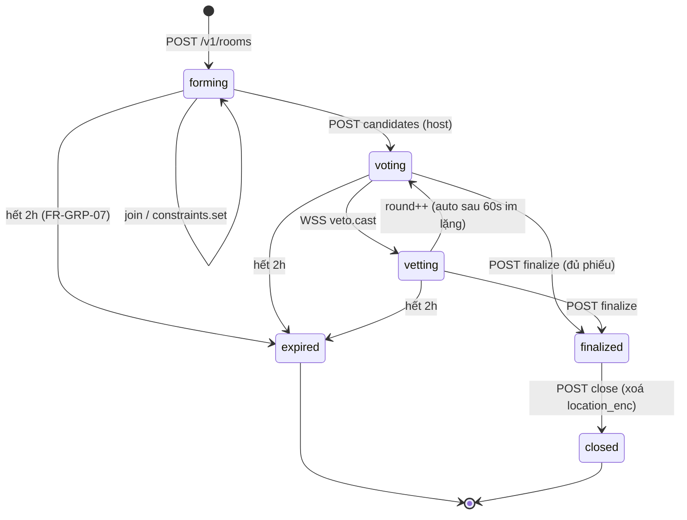

# 03 · Đặc tả API P2/P3 — input / output chi tiết

*Tuân thủ 100 % quy ước chung ở [`02-api-dac-ta.md`](./02-api-dac-ta.md) §1 (header, lỗi, phân trang, DTO `Place`/`Dish`/`OpenStatus`/`ScoreBreakdown`). File này **chỉ liệt kê phần khác**.*

Bản: **P2** = Nhóm, Nhật ký, Cá nhân hoá, Ngữ cảnh, Đóng góp quán. **P3** = Cộng đồng/đánh giá, cổng chủ quán, quảng cáo, widget, thống kê.

---

## 1. FR-GRP · Quyết định nhóm (module `group` + `group-ws`) — P2

### 1.0 Bản đồ lifecycle phòng



`phase` và `round` là 2 field luôn có trong **mọi** response/WS frame của phòng. Client **cấm** suy ra phase từ dữ liệu khác.

### 1.1 `POST /v1/rooms` — tạo phòng `FR-GRP-01`
**Auth**: Bearer **hoặc Guest** (không bắt buộc tài khoản — dùng chung phòng với bạn không cần đăng ký) · **Idempotency**: ✔
**Rate**: 10/phòng/giờ/user (chống spam mã phòng) · **SLA**: p95 < 400 ms

| Path | Kiểu | BẮT BUỘC | Ràng buộc | Mặc định | FR | Ý nghĩa |
| --- | --- | --- | --- | --- | --- | --- |
| `title` | string | ✖ | ≤ 40 | `"Nhóm trưa"` | | hiển thị trong app thành viên |
| `radius_m` | int | ✖ | 500–5000 | 2000 | GRP-02 | biên tìm ứng viên |
| `anchor` | enum | ✖ | `host`\|`midpoint`\|`place` | `host` | **GRP-04** | `midpoint` cần ≥ 2 thành viên đã đồng ý chia sẻ vị trí |
| `anchor_place_id` | string | khi `anchor=place` | `plc_...` | | | họp tại một quán đã biết |
| `filters` | object | ✖ | same shape `POST /v1/spins.filters` | từ host | ROU-02 | bộ lọc chung của phòng |
| `rounds_max` | int | ✖ | 1–5 | 3 | GRP-02 | số vòng bình chọn |
| `veto_enabled` | bool | ✖ | | **true** | GRP-02 | |
| `veto_per_member_per_round` | int | ✖ | 0–1 | 1 | SRS 6.3 | **mặc định đúng theo SRS: tối đa 1 veto/người/vòng** |
| `quorum_pct` | int | ✖ | 50–100 | 60 | GRP-05 | % thành viên phải bỏ phiếu trước khi finalize |
| `expires_in_min` | int | ✖ | 30–120 | **120** | **GRP-07** | server luôn `min(request, 120)` |
| `share_channel_hint` | enum | ✖ | `link`\|`code` | `code` | GRP-01 | |

**Output `201`**
```json
{
  "room": {
    "id": "rom_01J8Z6...", "code": "K7P3QM", "phase": "forming", "round": 0,
    "created_at": "2026-11-01T03:20:00Z", "expires_at": "2026-11-01T05:20:00Z", "version": 1,
    "host": { "member_id": "rmr_01J8...", "label": "Minh", "role": "host" },
    "members": [ { "member_id": "rmr_01J8...", "label": "Minh", "role": "host", "constraints_provided": false, "location_shared": false } ],
    "settings": { "radius_m": 2000, "anchor": "host", "veto_enabled": true, "rounds_max": 3, "quorum_pct": 60 },
    "candidate_count": 0, "link_valid_for_s": 7200
  },
  "join_url": "https://angi.example/j/K7P3QM",
  "ws_ticket": "wst_01J8...",
  "ws_url": "wss://api.angi.example/v1/rooms/rom_01J8Z6.../ws?ticket=wst_01J8..."
}
```
**Quy tắc code**
- `code` = 6 ký tự từ bảng **không đọc được thành từ** (loại `0/O/1/I/L`) → không đoán được (FR-GRP-01 "bằng mã hoặc liên kết"); entropy ≥ 32 bit, verify bằng so sánh constant-time.
- `join_url` chứa `join_token` **không** chứa `code` → link không thể bị brute-force từ code.
- Location của host **không** gửi lên server ở bước này nếu `anchor=host` mà host chưa consent — server dùng `user_location.is_default` geohash5 (coarse) thay vì toạ độ chính xác (SRS 11).

**Lỗi**: `429 ROOM_LIMIT` · `403 CONSENT_REQUIRED` (anchor=midpoint mà chưa đồng ý `group_sharing`) · `422 MIDPOINT_NEEDS_TWO_MEMBERS`.

### 1.2 `POST /v1/rooms/join` — vào phòng, **không cần tài khoản** `FR-GRP-01`
| Path | Kiểu | BẮT BUỘC | Ràng buộc |
| --- | --- | --- | --- |
| `code` | string | ✔ một trong | 6 ký tự, hoa/thường đều chấp nhận |
| `join_token` | string | ⃠ | từ deep link `angi://room/<token>` |
| `guest_label` | string | ✔ với khách | 1–24 ký tự, strip emoji control chars, **duy nhất trong phòng** (`409 LABEL_TAKEN`) |
| `device_id` | string | ✔ | để reconnect nhận diện lại thành viên cũ |
| `share_location` | bool | ✖ | mặc định `false` (tự nguyện — FR-GRP-04) |
| `constraints` | object | ✖ | như 1.3, gửi ngay để khỏi 2 round-trip |

**Output `200`**
```json
{
  "room_id": "rom_01J8Z6...", "member_id": "rmr_01J9...", "role": "member",
  "phase": "voting", "round": 1, "version": 7,
  "already_present": false,
  "members": [ { "member_id": "rmr_01J8", "label": "Minh", "role": "host", "constraints_provided": true, "location_shared": true },
               { "member_id": "rmr_01J9", "label": "Lan", "role": "member", "constraints_provided": false, "location_shared": false } ],
  "candidates": [ /* RoomCandidate[], xem 1.4 */ ],
  "tally": { "voting_open": true, "closes_in_s": 120, "quorum_met": false, "votes_cast": 2, "votes_required": 2 },
  "constraints_summary": { "budget_max_vnd": 60000, "hard_diet": ["seafood","vegetarian"], "member_count_with_constraints": 2,
                           "note_key": "grp.constraints.aggregated_anonymously" },
  "expires_at": "2026-11-01T05:20:00Z",
  "ws_ticket": "wst_01J9...", "ws_url": "wss://..."
}
```
**Đã vào rồi mà vào lại** (FR-GRP-06 "chịu mất kết nối và vào lại"): `device_id` khớp → **cấp lại đúng `member_id` cũ**, phiếu/veto giữ nguyên, `already_present: true`, server replay event từ `last_seq`.
**Phòng đầy**: `409 ROOM_FULL` (cap 12). **Code sai**: `404 ROOM_NOT_FOUND` (server **không** phân biệt "không tồn tại" và "sai code" → `code` không dò được). **Hết hạn**: `410 ROOM_EXPIRED`.

### 1.3 `PUT /v1/rooms/{id}/constraints` — ràng buộc riêng, tổng hợp ẩn danh `FR-GRP-03`
| Path | Kiểu | BẮT BUỘC | Ràng buộc | FR |
| --- | --- | --- | --- | --- |
| `budget_vnd` | int | ✖ | 15.000–2.000.000 | GRP-03 |
| `diet_strict` | string[] | ✖ | tag `kind ∈ diet,allergen` | GRP-03 |
| `diet_preferred` | string[] | ✖ | | |
| `regions` / `meal` / `temp` / `type` | | ✖ | như `POST /v1/spins` | |
| `avoid_place_ids` | string[] | ✖ | ≤ 20 ("tôi không ăn quán này nữa") | |
| `max_distance_m` | int | ✖ | 500–5000 | |
| `party_size` | int | ✖ | 1–12 | |
| `share_location` | bool | ✖ | tự nguyện; `true` ⇒ cần consent `group_sharing` | GRP-04 |

**Output `200`**
```json
{
  "member_id": "rmr_01J9...", "constraints_version": 3,
  "ack": { "budget_vnd": 50000, "diet_strict": ["peanut"], "max_distance_m": 2000 },
  "room_constraints_aggregate": {
    "budget_max_vnd": 60000, "budget_min_vnd": 40000,
    "hard_diet_union": ["peanut","seafood","vegetarian"],
    "max_distance_m": 2000, "members_counted": 3,
    "conflicts": [ { "type": "diet_vs_members_dishes", "detail_key": "grp.conflict.diet", "affected_candidates_removed": 4 } ]
  },
  "visibility_rule": "other_members_see_aggregate_only"
}
```
**Bất biến an toàn phải test (FR-GRP-03)** — 3 điểm dễ sai nhất khi code:
1. Aggregate trả về là **union** của `diet_strict` (ràng buộc cứng được tôn trọng với tất cả mọi người), nhưng **min** của `budget` (không ai bị ép chi quá khả năng).
2. Response **không** bao giờ có `member_id` nào gắn với ràng buộc cụ thể. Test: join bằng 2 client, sniff JSON, assert không path nào chứa `{member: constraint}`.
3. User A đổi constraint **sau khi** có candidate → server trả `409 CONSTRAINTS_CHANGED_REGENERATE` nếu candidate hiện tại vi phạm ràng buộc mới của A.

### 1.4 `POST /v1/rooms/{id}/candidates` — lập danh sách ứng viên `FR-GRP-02/04`
**Auth**: host (khách được promote làm host cũng được) · **Idempotency**: ✔
| Path | Kiểu | BẮT BUỘC | Ràng buộc | Mặc định | FR |
| --- | --- | --- | --- | --- | --- |
| `n` | int | ✖ | 3–8 | 5 | GRP-02 |
| `mode` | enum | ✖ | `ranked`\|`spins` | `ranked` | GRP-02 (quay chung) |
| `anchor` | enum | ✖ | ghi đè setting phòng: `host`\|`midpoint`\|`place` | room | **GRP-04** |
| `dish_ids` | string[] | ✖ | nếu nhóm đã chốt món trước | | REC-01 |
| `spin_each_dish` | bool | ✖ | mỗi ứng viên gắn 1 món khác nhau (tạo "quay chung") | false | ROU |
| `exclude_place_ids` | string[] | ✖ | quán từng bị veto ở vòng trước, server tự thêm | | GRP-02 |

**Output `200`**
```json
{
  "room_id": "rom_01J8...", "round": 1, "version": 8, "phase": "voting",
  "anchor": { "method": "midpoint", "members_used": 3, "geo": { "lat": 10.7802, "lng": 106.6975 }, "max_spread_m": 3100 },
  "candidates": [
    { "id": "rcd_01J8...", "place_id": "plc_01J8...", "place_name": "Bún bò O Xuân",
      "dish": { "id": "dsh_01J8", "name": "Bún bò Huế" },
      "distance_m": 640, "avg_price_vnd": 42000, "rating_bayesian": 4.28,
      "open_status": { "is_open": true, "closes_in_min": 55, "closing_soon": false, "o_score": 1.0 },
      "score_breakdown": { "score_total": 71.60, "top_component": "D", "components": [ /* rút gọn */ ] },
      "status": "active", "vetoes": 0, "votes": 0 } ],
  "rejected_by_hard_constraints": { "count": 9, "by_reason": [
      { "reason": "diet:peanut", "count": 4, "sample_names": ["Phở gia truyền"] },
      { "reason": "budget", "count": 3 }, { "reason": "closed", "count": 2 } ] },
  "voting_open_until": "2026-11-01T03:24:00Z"
}
```
- `anchor.method="midpoint"`: server tính **centroid có trọng số** (geographic median qua PostGIS) từ các thành viên tự nguyện chia sẻ; `members_used` nói rõ ai được tính — app phải hiện "3/5 người chia sẻ vị trí".
- `rejected_by_hard_constraints` là lời giải thích **tập thể**, không quy về cá nhân (GRP-03).
- 0 ứng viên → `200` + `candidates: []` + `steps_available[]` nới (radius, budget) — giống logic relaxation FR-REC-05. **Không** trả `404`.

### 1.5 `POST /v1/rooms/{id}/votes` — REST fallback (chính là WSS `vote.cast`) `FR-GRP-02`
| Path | Kiểu | BẮT BUỘC | Ràng buộc |
| --- | --- | --- | --- |
| `member_id` | string | ✔ | **server verify token ↔ member**, không cho spoof (IDOR test) |
| `candidate_ids` | string[] | ✔ một trong | approval voting: nhiều lựa chọn thuận, `status` giữ nguyên |
| `ranked_candidate_ids` | string[] | ⃠ | xếp hạng 1..n, mỗi id ≤ 1 lần |
| `round` | int | ✔ | phải bằng `room.round` hiện tại → `409 ROUND_CLOSED` |
| `client_seq` | int | ✔ | idempotent trong kết nối; trùng ⇒ replay |

**Output `200`** `{ "tally": [ { "candidate_id":"rcd_...", "votes": 2, "share_pct": 40.0, "rank_sum": 3, "vetoed": false } ], "version": 9, "quorum_met": false, "closes_in_s": 88 }`
WSS frame tương ứng gửi tới **mọi** thành viên trong < 200 ms: `{"type":"vote.updated","seq":43,"payload":{"tally":[...],"votes_cast":3,"votes_required":5,"version":9}}`
Quy tắc: **phiếu cuối cùng ghi đè** (không cộng dồn) cho cùng `(member, candidate, round)`; unique constraint chặn double-vote.

### 1.6 `POST /v1/rooms/{id}/vetoes` — veto `FR-GRP-02`, SRS 6.3
**Input**: `{ "candidate_id": "rcd_...", "round": 1, "reason_key": "veto.tried_and_disliked"|null }` (không bắt buộc nhập lý do bằng text → tránh spam/mất thời gian).
**Output `200`**: `{ "candidate_id":"rcd_...", "status":"vetoed", "vetoes":1, "remaining_for_me":0, "version":10 }`
**Lỗi**
| HTTP | code | Khi nào |
| --- | --- | --- |
| 409 | `VETO_LIMIT_REACHED` | đã dùng 1 veto vòng này (SRS 6.3) |
| 409 | `ROUND_CLOSED` | round != hiện tại |
| 422 | `CANNOT_VETO_LAST_CANDIDATE` | veto sẽ làm rỗng danh sách → server từ chối, buộc phải thay bằng vote down |
| 403 | `VETO_DISABLED` | room setting `veto_enabled=false` |
**Ẩn danh**: frame fan-out chỉ có `{candidate_id, vetoes: 1}`, **không** có `member_id` người veto. Đây là yêu cầu "công bằng khi đi nhóm" (SRS 2.1) — test sniff.

### 1.7 `POST /v1/rooms/{id}/finalize` — chốt + bằng chứng kiểm chứng `FR-GRP-05`
**Auth**: host · **Idempotency**: ✔ (double-tap → không quay 2 lần ra 2 kết quả khác nhau)
| Path | Kiểu | BẮT BUỘC | Ràng buộc |
| --- | --- | --- | --- |
| `expected_version` | int | ✔ | optimistic lock → `409 ROOM_VERSION_STALE` |
| `force` | bool | ✖ | cho phép chốt dưới quorum, phải có `force_reason` |
| `force_reason` | string | khi `force` | ≤ 100 |

**Thuật toán (SRS 6.3) — implement đúng thứ tự**
1. Lọc `status='active'` (đã loại ứng viên bị veto).
2. `points = số phiếu thuận` (approval) hoặc `Borda` từ `ranked_candidate_ids`.
3. Nếu **1 ứng viên điểm cao nhất duy nhất** → winner, `method="majority"`.
4. Nếu **hòa** → weighted spin trên các ứng viên hòa, `w_i = points_i` (điểm làm trọng số), CSPRNG, `method="tie_weighted_spin"`.
5. Nếu **không ai bỏ phiếu** → `method="no_votes_top_score"` = ứng viên `score_total` cao nhất, app phải nói rõ là "hệ thống chọn, nhóm chưa bỏ phiếu".

**Output `200`**
```json
{
  "room_id": "rom_01J8...", "phase": "finalized", "version": 12,
  "winner": { "candidate_id": "rcd_01J8...", "place_id": "plc_01J8...", "place_name": "Bún bò O Xuân",
              "dish": { "id": "dsh_01J8", "name": "Bún bò Huế" },
              "distance_m": 640, "open_status": {}, "score_breakdown": {},
              "one_tap": { "method": "GET", "path": "/v1/places/plc_01J8...", "deep_link": "https://maps.google.com/?daddr=10.7761,106.7039" } },
  "decision": { "method": "tie_weighted_spin", "tied_candidate_ids": ["rcd_A","rcd_B"],
                "weights_used": { "rcd_A": 2, "rcd_B": 2 }, "reason_key": "grp.tie.spun" },
  "proof": {
    "seed_b64": "9YdQ...", "pool_hash": "sha256:7b2f...", "sha256_result": "sha256:41ac...",
    "algorithm": "tie-weighted-csprng-v1", "verifiable_at": "/v1/rooms/rom_01J8.../proof",
    "formula": "H(seed || candidate_ids_sorted || winner_id || round)" },
  "tally_final": [ { "candidate_id":"rcd_A","votes":2,"share_pct":40.0,"vetoed_by":0,"rank_sum":3 },
                   { "candidate_id":"rcd_B","votes":2,"share_pct":40.0,"vetoed_by":1,"rank_sum":4 } ],
  "participation": { "members": 5, "voted": 4, "vetoed": 2, "quorum_met": true },
  "next": { "ask_review_after_visit": true, "journal_prefill": { "place_id":"plc_01J8...", "dish_id":"dsh_01J8" } }
}
```
**Bất biến (test bắt buộc)**: chạy lại `finalize` với **cùng** `seed` + `pool_hash` phải ra **cùng** `winner` (hàm thuần). Người thứ 3 trong nhóm gọi `GET /proof` với `seed` tự tính hash → khớp ⇒ không ai "đứng sau máy chủ" được (FR-GRP-05, chống nghi ngờ SRS 12.3).

### 1.8 `GET /v1/rooms/{id}` · `GET /v1/rooms/{id}/proof` · `POST /v1/rooms/{id}/close` · `POST /v1/rooms/{id}/transfer-host`
| Endpoint | Input | Output | FR |
| --- | --- | --- | --- |
| `GET /v1/rooms/{id}` | `?sections=core,members,candidates,tally,proof`; guest cần `member_id`+`device_id` hoặc `join_token` | như 1.2 + `server_now` để app sync đồng hồ | GRP-01/06 |
| `GET /v1/rooms/{id}/proof` | — | `{seed_b64, pool_hash, sha256_result, algorithm, method, weights_used, tally_final, formula, audit:[{seq,type,ts}]}` — **public, đọc được không cần token** (bằng chứng cho mọi người) | **GRP-05** |
| `POST /v1/rooms/{id}/close` | `{reason: "eaten"\|"abandoned"\|"wrong_place"}` | `200 {closed:true, location_data_purged:true, proof_retained:true}`; **hard-delete** `room_member.location_enc`, `constraints raw`, `candidate` chi tiết; giữ `room.proof` + tally đã anon | **GRP-07** |
| `POST /v1/rooms/{id}/transfer-host` | `{to_member_id}` hoặc tự động khi host `DELETE /v1/rooms/{id}/leave` | `200 {host:{member_id,label}}` + WSS `room.host_changed` | UC-02 ngoại lệ |

### 1.9 `POST /v1/rooms/{id}/ws-ticket` + Kênh WSS `FR-GRP-06`
`POST /v1/rooms/{id}/ws-ticket` → `{ "ticket":"wst_01J9...", "expires_in":30, "ws_url":"wss://...?ticket=...&last_seq=41" }`
TTL 30 s, một lần, bound `(room_id, member_id)` — JWT không đi qua URL (tránh leak trong access log).

**Client → Server (`type`, `payload`, `client_seq`)**
| type | payload | Trả về | Ghi chú |
| --- | --- | --- | --- |
| `subscribe` | `{last_seq:int\|null}` | `room.snapshot` | bắt buộc sau khi connect |
| `member.constraints.set` | như 1.3 | `constraints.updated` | |
| `vote.cast` | `{candidate_ids[], ranked[]?, round}` | `vote.updated` | ghi đè phiếu cũ |
| `vote.retract` | `{candidate_id, round}` | `vote.updated` | |
| `veto.cast` | `{candidate_id, round}` | `veto.added` \| `error:VETO_LIMIT_REACHED` | |
| `veto.retract` | `{candidate_id, round}` (chỉ khi chưa ai vote sau đó) | `veto.removed` | |
| `candidates.generate` | như 1.4 | `candidates.ready` | chỉ host |
| `spin.request` | `{}` | `spin.result` | "quay chung" tức thời |
| `typing` / `ping` | `{ts}` | `pong` | heartbeat 25 s |

**Server → Client**: `{"type","seq","server_ts","payload"}` với `type ∈` `room.snapshot`, `member.joined`, `member.left`, `host.changed`, `constraints.updated`, `candidates.ready`, `vote.updated`, `veto.added`, `veto.removed`, `round.advanced`, `phase.changed`, `spin.result`, `result.finalized`, `room.expiring` (`T−5 phút`, để app nhắc), `room.expired`, `error`, `pong`.

**Yêu cầu kỹ thuật để đạt `< 2 giây` (FR-GRP-06)** — đây là chỗ hay fail khi code:
1. Fan-out qua **Redis Pub/Sub** theo channel `room:<id>`, không poll DB.
2. `seq` do **Redis INCR** (atomic) — không dùng timestamp làm seq (hai event cùng ms là mất thứ tự).
3. Event store: `XADD room:<id>:stream` với `MAXLEN ~ 500` để replay `last_seq`.
4. Instance `group-ws` giữ kết nối; khi scale nhiều pod → **consistent hashing theo `room_id`** để 1 phòng nằm trên 1 pod (giảm broadcast liên pod).
5. Client phải xử lý `409 ROOM_VERSION_STALE` bằng cách `GET /v1/rooms/{id}` rồi re-apply ý định.

### 1.10 `POST /v1/spins` trong chế độ nhóm (tái dùng endpoint P1)
Không có API riêng. Client gửi `POST /v1/spins` với `party_size`, `filters`, `diet.override_strict = union các hard_diet` **đã aggregate** → cùng một engine (FR-GRP-02 "quay chung"). Server lưu `spin.room_id` (nullable) để trace.

---

## 2. FR-JRN · Nhật ký ăn uống — P2

### 2.1 `GET /v1/journal/visits` — lịch sử, filter + cursor
| Query | Kiểu | Mặc định | Ràng buộc | FR |
| --- | --- | --- | --- | --- |
| `from` / `to` | date-time | 30 ngày gần | ≤ 5 năm | JRN-01 |
| `place_id` / `dish_id` / `list_id` | string | | | |
| `status` | csv | tất cả | `chosen,arrived,completed` | |
| `rating_min` | int | 0 | 1–5 | JRN-03 |
| `q` | string | | 2–60 ký tự, `pg_trgm` trên note/place name | |
| `cursor` / `limit` | | 20 | 1–50 | |

**Output `200`**
```json
{ "items": [ {
    "id": "vst_01J8...", "occurred_at": "2026-10-30T10:12:00Z", "status": "completed",
    "place": { "id":"plc_01J8...", "name":"Bún bò O Xuân", "geo":{}, "price_level":2 },
    "dish": { "id":"dsh_01J8...", "name":"Bún bò Huế" },
    "spend_vnd": 45000, "private_rating": 4, "note": "Nước ngọt, hơi mặn",
    "photos": [ { "upload_id":"upl_...", "url":"https://cdn..." } ],
    "source": "nav_open", "spin_id": "spn_01J8...", "sync_state": "synced", "updated_at": "..."
} ], "page": {}, "meta": {} }
```
`sync_state: synced|pending|conflict` — app hiện icon mây/dồng hồ; `conflict` ⇒ user chọn 1 trong 2 (xem 2.5).

### 2.2 `POST /v1/journal/visits` — xem `02` §6.1 (P2 thêm `spend_vnd`, `note`, `private_rating`, `upload_ids`)
### 2.3 `PATCH /v1/journal/visits/{id}` · `DELETE /v1/journal/visits/{id}`
`PATCH`: merge-patch bất kỳ field ghi được ở 2.1 + `status`. **Output** entity mới + `version`. `409 VERSION_CONFLICT` nếu `If-Match` sai.
`DELETE`: `204`; soft-delete 30 ngày → `POST /v1/journal/visits/{id}/restore` (P2, mobile rất hay xoá nhầm).

### 2.4 Favorites & danh sách tuỳ chỉnh `FR-JRN-02`
| Method | Path | Input | Output |
| --- | --- | --- | --- |
| `GET` | `/v1/journal/favorites` | `?cursor&limit` | `items[] {place_id, place_name, added_at, list_ids[]}` |
| `POST` | `/v1/journal/favorites` | `{place_id ✔}` | `201 {place_id, added_at}`; duplicate ⇒ `200` bản cũ |
| `DELETE` | `/v1/journal/favorites/{place_id}` | | `204` |
| `GET` | `/v1/lists` | | `items[] {id, name, kind: favorites\|custom, item_count, updated_at, is_default_favorites}` |
| `POST` | `/v1/lists` | `{name ✔ ≤40, kind: custom ✔}` ("Quán công ty", "Hẹn hò") | `201` list |
| `PATCH` | `/v1/lists/{id}` | `{name, color, icon}` | `200` |
| `DELETE` | `/v1/lists/{id}` | | `204` — items **không** bị xoá khỏi favorites chung |
| `POST` | `/v1/lists/{id}/items` | `{place_id ✔, note ≤100, position int}` | `201` |
| `DELETE` | `/v1/lists/{id}/items/{place_id}` | | `204` |
| `POST` | `/v1/lists/{id}/reorder` | `{place_ids_ordered[] ✔}` (đủ mọi item) | `200` |

`POST /v1/lists/{id}/share` (P3) → `{share_url, expires_at}` read-only, không cho phép người nhận sửa.

### 2.5 ⭐ `POST /v1/journal/sync` — đồng bộ đa thiết bị, hợp nhất xung đột `FR-JRN-05`
**Là endpoint phức tạp nhất của P2 — code riêng, test riêng.**
| Path | Kiểu | BẮT BUỘC | Ràng buộc | Ý nghĩa |
| --- | --- | --- | --- | --- |
| `device_id` | string | ✔ | | thiết bị đang push |
| `last_server_seq` | int | ✔ | `0` lần đầu | điểm tiếp nối |
| `push[]` | array | ✔ (có thể rỗng) | ≤ 500 op/lần | các thao tác offline đã tích luỹ |
| `push[].op` | enum | ✔ | `create`\|`update`\|`delete`\|`restore` | |
| `push[].kind` | enum | ✔ | `visit`\|`favorite`\|`list`\|`list_item`\|`exclusion` | |
| `push[].local_id` | string | ✔ | ULID do app sinh ⇒ idempotent, không cần `X-Idempotency-Key` riêng | |
| `push[].data` | object | ✔ | entity | |
| `push[].device_updated_at` | date-time | ✔ | đồng hồ máy user, có thể sai | |
| `push[].base_version` | int | ✔ (update/delete) | version app đọc lần cuối | phát hiện conflict |
| `pull_since` | int | ✖ | = `last_server_seq` | |

**Output `200`**
```json
{
  "server_seq": 1842, "accepted": [ { "local_id":"01J8...A", "id":"vst_01J8...A", "version": 3 } ],
  "rejected": [ { "local_id":"01J8...B", "code":"VERSION_CONFLICT",
                  "server_entity": { "id":"vst_...", "version":5, "note":"...", "updated_at":"..." },
                  "client_entity": { "note":"...", "device_updated_at":"..." },
                  "resolution_options": ["keep_server","keep_client","merge_fields","keep_both"],
                  "auto_resolution": "last_writer_wins_by_server_received_at",
                  "suggested": "merge_fields" } ],
  "pull": [ { "kind":"visit", "op":"update", "entity": { }, "server_seq":1840 } ],
  "has_more": true, "next_server_seq": 1841,
  "device_clock_skew_s": -86400, "clock_warning": true,
  "meta": { "merged": { "visits": 12, "favorites": 2 }, "server_time": "..." }
}
```
**Chiến lược hợp nhất — viết rõ để code không mơ hồ**
| Loại dữ liệu | Cách merge | Vì sao |
| --- | --- | --- |
| `visit` create | cộng dồn theo `local_id` (unique) | không bao giờ mất bữa đã ghi offline |
| `visit` update | `merge_fields`: mỗi field so `device_updated_at`, **nhưng** clamp nếu skew > 5 phút ⇒ dùng `server received_at` | điện thoại đổi giờ/tz là chuyện hằng ngày |
| `visit` delete vs update | `update` thắng, sinh conflict `deleted_then_edited` → hỏi user | xoá mất bữa ăn là mất dữ liệu, nặng hơn |
| favorite / list_item | set union cho add, LWW cho remove + giữ tombstone 30 ngày | 2 máy cùng thêm không thành 2 bản |
| `dish_exclusion` | union add, LWW remove | |
| conflict mà client không trả lời trong 7 ngày | server chốt `last_writer_wins` và ghi audit | phòng khi user bỏ device |

`clock_warning: true` ⇒ app hiện hướng dẫn "đồng bộ thời gian máy" (NFR-09) và **không** hiển thị badge conflict cho user (server đã tự xử).
Rate: 6 req/phút/device, `push` > 500 op ⇒ `413 PAYLOAD_TOO_LARGE` (app phải chia trang).

### 2.6 `GET /v1/journal/summary` — tổng kết tuần/tháng `FR-JRN-04` (P3)
`?period=week|month&date=2026-10-27&tz=Asia/Ho_Chi_Minh`
```json
{
  "period": { "kind": "week", "start": "2026-10-27", "end": "2026-11-02" },
  "meals_count": 9, "places_count": 7, "new_places": 2, "total_spend_vnd": 385000,
  "avg_spend_vnd": 42778, "budget_vnd": 350000, "budget_over_pct": 10.0,
  "top_dishes": [ { "dish_id":"dsh_01J8", "name":"Bún bò Huế", "count": 3 } ],
  "top_regions": [ { "region":"south", "share_pct": 55.6 } ],
  "diversity": { "distinct_categories": 5, "distinct_price_levels": 2, "hhi_index": 0.18,
                 "label_key": "summary.diversity.varied", "compare_last_period_delta": +2 },
  "price_level_mix": { "1": 1, "2": 5, "3": 2, "4": 1 },
  "weekday_pattern": [ { "dow": 1, "count": 2 } ],
  "insights": [ { "key":"summary.insight.lunch_out_heavy", "params":{ "share":"67" } },
                { "key":"summary.insight.revisit_risk", "params":{ "dish":"cơm tấm", "days_gap":"4" } } ]
}
```
`hhi_index` (chỉ số tập trung món) là cách đo "mức đa dạng món" một cách định nghĩa được → **team QA cần con số này để test**, không test bằng cảm tính.

### 2.7 `GET /v1/journal/export?format=csv|json` — `FR-JRN-06`
Giống `GET /v1/me/export` (02 §2.9) nhưng scope chỉ nhật ký; trả `202 {export_id, poll_url}`. CSV columns: `visit_id,occurred_at,status,place_id,place_name,address,dish_id,dish_name,category,price_level,spend_vnd,private_rating,note,photo_urls,source,spin_id`. UTF-8 BOM + `\r\n` để Excel VN mở không lỗi font (test bằng Excel thật, không chỉ bằng `cat`).

---

## 3. FR-REC · Ngữ cảnh, cá nhân hoá, bias — P2

### 3.1 `GET /v1/context?geo&at` — debug/preview ngữ cảnh server đang thấy (FR-REC-07)
```json
{ "local_time": "11:20", "dow": 3, "is_weekend": false, "hour_bucket": "lunch",
  "meal_suggested": "lunch", "weather": { "temp_c": 31, "condition": "rain", "is_rainy": true },
  "is_month_end": false, "holiday": null, "month_name": "11",
  "weight_overrides": { "O": 0.20, "D": 0.30 }, "override_reason_keys": ["ctx.rain.prefer_close", "ctx.lunch.prefer_open"] }
```
`POST /v1/matches` **tự** gọi logic này khi client không gửi `context`. Endpoint này tồn tại để test: QA so sánh `context_used` trong response match với `GET /v1/context` cùng tham số ⇒ phát hiện weather API sai/cache cũ.

### 3.2 `preference_bias` (FR-REC-08) — 1 thanh trượt, không phải API mới
Gửi trong `POST /v1/matches`: `{ "closer": 0.6, "tastier": -0.2, "cheaper": 0.0 }` ∈ [−1, 1].
**Cách server dịch ra trọng số** (mã hoá công khai để dev/test cùng hiểu):
```
w_D = 0.25 * (1 + 0.8*closer)      w_Q = 0.35 * (1 + 0.8*tastier)     w_P = 0.15 * (1 + 0.8*cheaper)
sau đó normalize Σw = 1 (trừ O và U giữ nguyên)
```
`GET /v1/config` trả `bias_ranges` để app vẽ slider đúng khoảng. Test TC-REC-08: 3 giá trị bias khác nhau trên **cùng** dataset ⇒ **đổi thứ tự** nhưng **không đổi** `score_breakdown.formula_version` và `penalty`.

### 3.3 `GET /v1/routes/estimate` — thời gian di chuyển (FR-NAV-03)
| Query | Kiểu | BẮT BUỘC | Ràng buộc |
| --- | --- | --- | --- |
| `origin_geo` \| `user_location_id` | | ✔ | |
| `place_ids` | csv | ✔ | ≤ 20 id |
| `travel_mode` | enum | ✖ | `walk\|bike\|car` |
| `depart_at` | date-time | ✖ | default now |

`200`: `{ "items":[{ "place_id":"plc_...", "travel_mode":"bike", "duration_min":7, "distance_m":1900, "traffic":"moderate" }], "meta":{"data_quality":"cached","provider":"google","cache_age_s":540} }`
Cache theo `(geohash6 origin, geohash6 destination, mode, hour_bucket)` TTL 1 h; **bắt buộc** có fallback `duration_min = distance_m / speed_default` khi provider chết (`meta.provider:"estimated"`) — không để UI trống (NFR-06).

### 3.4 Tắt cá nhân hoá (FR-REC-06) — 3 cách, cùng một effect
| Cách | Nơi | Result |
| --- | --- | --- |
| `personalization=false` trong `/v1/matches` | theo lượt | `U = 0.0`, trọng số redistribute, `meta.personalization_used:false` |
| `profile.personalization_opt_in=false` | vĩnh viễn | như trên cho mọi request |
| `DELETE /v1/me` | tuyệt đối | xoá `visit`, `spin`, `user_list` → `U` luôn 0 |
UI phải có giải thích "tắt thì gợi ý sẽ kém hợp hơn nhưng riêng tư hơn" (NFR-08 + 2.6.4 minh bạch).

---

## 4. FR-COM · Cộng đồng, đánh giá, kiểm duyệt — P2 (đề xuất) / P3 (reviews)

### 4.1 `POST /v1/places` — đề xuất quán mới `FR-COM-01` (P2)
**Idempotency**: ✔ · **Rate**: 3/ngày/user (đã verify) · **Auth**: bắt buộc tài khoản đầy đủ (guest không được)
| Path | Kiểu | BẮT BUỘC | Ràng buộc | Ghi chú |
| --- | --- | --- | --- | --- |
| `name` | string | ✔ | 3–80 | |
| `category_id` | string | ✔ | node lá | bắt buộc để ánh xạ món (FR-REC-01) |
| `geo` | GeoPoint | ✔ | ±100 m so với user hiện tại hoặc `observation_geo` | chống spam quán ảo ở nơi không có mặt |
| `address` | string | ✔ | 5–200 | |
| `price_level` | int | ✔ | 1–4 | |
| `cuisine_tags` | string[] | ✖ | ≤ 6 | |
| `dish_ids` | string[] | ✖ | ≤ 20 món quán bán | |
| `hours_by_dow` | array | ✖ | 7 mục | |
| `phone_e164` | string | ✖ | normalize | |
| `upload_ids` | string[] | ✖ | ≤ 6, verify EXIF → **strip GPS** trước khi lưu (SRS 11) | |
| `note` | string | ✖ | ≤ 300 | |

`201`: `{ "place_id":"plc_01J8...", "status":"pending_review", "moderation_queue_position": 12, "estimated_review_s": 86400, "credited": { "points": 5, "badge_key":"contrib.new_place" } }`
**Bất biến**: `status="pending_review"` ⇒ **không** xuất hiện trong `/v1/places/nearby`, `/v1/matches` của bất kỳ ai cho tới khi admin `accept`. Test TC-COM-01 là test **visibility**, không phải test 201.

### 4.2 `PATCH /v1/places/{id}` — đề xuất chỉnh sửa thông tin `FR-COM-01`
Body: merge-patch các field được phép (`name, address, geo, price_level, hours_by_dow, cuisine_tags, dish_ids`), **bắt buộc** `reason` ≤ 300 ký tự.
`202 { "change_id": "chg_...", "status":"pending_review", "diff": { "hours_by_dow": { "from":[], "to":[] } } }`
Xung đột: nếu 2 người đề xuất thay đổi cùng field → cả 2 vào queue, admin thấy cả 2 `diff`. Không auto-merge (P2 chỉ có 1 thành phố, kiểm duyệt tay được).
`GET /v1/places/{id}/suggestions?mine=true` → lịch sử đóng góp của user.

### 4.3 `POST /v1/reviews` — đánh giá nhanh 3 chạm `FR-COM-02` (P3)
**Idempotency**: ✔ · **Rate**: FR-COM-03 — 5 đánh giá/ngày, 20/tuần, 1 **effective**/quán/user
| Path | Kiểu | BẮT BUỘC | Ràng buộc | Ý nghĩa |
| --- | --- | --- | --- | --- |
| `place_id` | string | ✔ | | |
| `verdict` | enum | ✔ | `good`\|`ok`\|`bad` | chạm 1 |
| `tags` | string[] | ✖ | ≤ 5, `review_tag` enum per category (chạm 2) | `spicy`,`cheap`,`friendly`,`slow`,`small`,`value`,`clean` |
| `text` | string | ✖ | 0–500 (chạm 3, **optional** → mới là "3 chạm") | |
| `dish_ids` | string[] | ✖ | ≤ 5 | |
| `visit_id` | string | ✖ | nếu có ⇒ `checkin_verified=true`, xếp ưu tiên hiển thị | FR-COM-02 |
| `rating` | int | ✖ | 1–5; nếu bỏ thì suy từ `verdict` (`good=5, ok=3, bad=1`) | |

`201`
```json
{ "id":"rev_01J8...", "status":"published", "is_effective": true,
  "superseded_review_id": "rev_01J7...", "checkin_verified": true,
  "place_rating_after": { "avg": 4.39, "count": 183, "bayesian": 4.27 },
  "credited": { "points": 2 } }
```
**FR-COM-03 chống đánh giá ảo — 5 lớp, implement đủ 5 lớp**
| Lớp | Rule | Khi vi phạm |
| --- | --- | --- |
| 1 | 1 review effective/(user, place) | review mới `supersede` bản cũ (old `is_effective=false`), không cộng 2 lần vào `avg` |
| 2 | tần suất 5/ngày, 20/tuần | `429 REVIEW_RATE_LIMIT` |
| 3 | không có `visit`/`checkin` trong 30 ngày + `verdict=bad` ⇒ `status=pending` | vào queue kiểm duyệt, `is_effective=false` tới khi duyệt |
| 4 | bất thường: ≥ 3 review `bad` cho cùng quán từ device mới + cùng ip range trong 10′ | tự động `flagged`, `place.review_suspicion=0.7` → penalty trong Score |
| 5 | device/user tier (guest mới, không có visit nào) | cap 1 review/ngày |
`PUT /v1/reviews/{id}` (sửa, `version` + `edited_at`, gắn nhãn "đã sửa"), `DELETE /v1/reviews/{id}` (`204`, `is_effective=false`, **không** hard delete để giữ audit), `GET /v1/places/{id}/reviews?sort=relevant|recent|checkin_first&verdict&cursor`.

### 4.4 `POST /v1/reports` — báo cáo nội dung `FR-COM-04` (P3)
Input: `{ "target_type": "review|user|place|photo" ✔, "target_id" ✔, "kind": "spam|fake|harassment|wrong_info|offensive|privacy" ✔, "detail" ≤500, "idempotency" header }`
`201 { "report_id":"rpt_...", "status":"open", "moderation_sla_hours": 72, "cooldown_s": 3600 }`
`GET /v1/reports/mine?status&cursor` → each `{report_id, target, kind, status, decision, appeal_open:boolean, appeal_deadline}` (quy trình kháng nghị).

### 4.5 Kiểm duyệt (admin, FR-ADM-04 P2 + FR-COM-04 P3)
| Method | Path | Input | Output |
| --- | --- | --- | --- |
| `GET` | `/v1/admin/moderation/queue?kind=new_place\|place_edit\|review\|report&city&cursor` | | `items[]` kèm `diff`, `contributor_trust`, `similarity_to_existing_place_pct` (hỗ trợ khử trùng lặp trước khi accept) |
| `POST` | `/v1/admin/moderation/{item_id}/decision` | `{decision: accept\|reject\|needs_more_info ✔, applied_change?, note_to_user ≤300, strike_user: bool}` | `200` + `publish_now: bool`; `accept` mới **đổi ranking** (penalty/confidence) — bất biến đã nêu ở `02` §4.7 |
| `POST` | `/v1/admin/users/{id}/strike` · `POST /v1/admin/users/{id}/ban` | `{reason ✔, duration_days: null=permanent}` | `200 {active_restrictions:[...]}`; 3 strike tự soft-ban |
| `GET` | `/v1/admin/contributors?sort=trust` | | bảng xếp hạng đóng góp |

---

## 5. FR-ROU mở rộng & FR-PER widget — P2/P3

| Endpoint | Method | Input | Output | FR |
| --- | --- | --- | --- | --- |
| `/v1/wheels` | `GET` | `?cursor` | `items[] {id, name, item_count, dish_ids[], is_shared, created_at}` | ROU-11 |
| `/v1/wheels` | `POST` | `{name ✔ ≤40, dish_ids[] ✔ 2–40, list_id ⃠, category_id ⃠}` (1 trong 2 nguồn id) | `201` wheel | ROU-11 |
| `/v1/wheels/{id}` | `PUT` | patch | `200` | ROU-11 |
| `/v1/wheels/{id}` | `DELETE` | | `204` | ROU-11 |
| `/v1/wheels/{id}/share` | `POST` | `{expires_days: 7\|30\|null}` | `{share_url, share_code}` — người nhận `POST /v1/wheels/from-share {share_code}` → `201` bản copy | ROU-11 |
| `/v1/spins` | `POST` | thêm `wheel_id` → **bỏ** anti-repeat và diet soft pref, giữ diet **hard** (an toàn sức khoẻ vẫn trên hết) | như `02` §3.3 + `pool.source:"wheel"` | ROU-11/03 |
| `/v1/spins/{id}/share-card` | `POST` | `{style: "classic\|story\|square", include_place: bool, locale}` | `200 {image_url (signed 15′), alt_text_vi, alt_text_en}` server-side render PNG/WebP | ROU-13 |
| `/v1/me/budget` | `PUT` | xem `02` §5.3 | | PER-02 |
| `/v1/widget/quick-spin` | `GET` | `?token=<widget-token>` (iOS widget không đọc được keychain) → token short-lived do app chính cấp qua App Group | `200 {dish, animation:null, deep_link:"angi://spin/result/spn_..."}` — widget **không** tự quay bằng logic riêng | PER-04 |

---

## 6. FR-MER · Cổng chủ quán — P3

### 6.1 `POST /v1/merchant/claims` — xác minh quyền sở hữu `FR-MER-01`
| Path | Kiểu | BẮT BUỘC | Ràng buộc |
| --- | --- | --- | --- |
| `place_id` | string | ✔ | |
| `legal_name` | string | ✔ | ≤ 100 |
| `business_reg_no` | string | ✖ | MST 10/13 số (verify format, **không** verify nội dung ở P3) |
| `contact_phone_e164` | string | ✔ | sẽ nhận OTP xác minh |
| `contact_email` | string | ✔ | sẽ nhận link 24 h |
| `documents_upload_ids` | string[] | ✖ | ≤ 5, lưu **mã hoá**, xoá sau 90 ngày nếu reject |
| `place_address_match` | bool | ✔ | chủ quán tự khai đã tới địa chỉ |

`201 { "claim_id":"clm_...", "status":"pending", "steps_remaining":["phone_otp","email_link"], "sla_days":5 }`
`POST /v1/merchant/claims/{id}/verify-phone {code}` · `POST .../verify-email {token}` → `200 {status:"verified_owner", role:"merchant", place_ids_managed:["plc_..."]}`
Từ chối: `409 ALREADY_CLAIMED` (kèm `appeal_url`), `422 DOCUMENT_UNREADABLE`.

### 6.2 API quản lý hồ sơ quán (role `merchant`, chỉ quán mình sở hữu)
| Method | Path | Input | Output / hành vi |
| --- | --- | --- | --- |
| `PUT` | `/v1/merchant/places/{id}/hours` | `hours_by_dow[7]`, `exceptions[]` | `200 {applied_at, cache_invalidated:true}` — **có hiệu lực ngay** vào `open_status` (FR-MER-01). Merchant không cần qua kiểm duyệt cho field của chính họ ⇒ vì vậy phải audit + giới hạn 5 sửa/ngày |
| `PUT` | `/v1/merchant/places/{id}/menu` | `{dishes[] {dish_id?, name, price_vnd, available:bool, image_upload_id?}}` | `200 {updated, unmatched_dishes[]}` + tự cập nhật `place_dish.confidence=1.0` (nguồn chủ quán là tin cậy nhất, xem `01` §4.8) |
| `POST` | `/v1/merchant/places/{id}/status` | `{closed_temporarily:bool, until: date-time, reason_key}` | quán bị loại khỏi mọi kết quả tới `until` |
| `GET` | `/v1/merchant/places/{id}/insights` | `?from&to` | `{impressions, nav_clicks, nav_click_rate, urgent_appearances, top_dishes[], reviews_pending[], competitor_avg_price}` |
| `GET` | `/v1/merchant/reports?for_place_id` | | các report về quán mình + cách khắc phục (`FR-PLC-07` loop đóng) |

### 6.3 `POST /v1/merchant/promotions` — gói Nổi bật minh bạch `FR-MER-02`
| Path | Kiểu | BẮT BUỘC | Ràng buộc |
| --- | --- | --- | --- |
| `place_id` | string | ✔ | đã verified owner |
| `format` | enum | ✔ | `highlight_card`\|`top_badge`\|`city_takeover` |
| `budget_vnd` | int | ✔ | ≥ 200.000 |
| `starts_at` / `ends_at` | date-time | ✔ | ≤ 30 ngày |
| `targeting` | object | ✖ | `{radius_m, meal[], dish_ids[], price_level[]}` |

`201 { "promotion_id":"prm_...", "status":"scheduled", "label_required": "Quảng cáo", "affects_natural_rank": false }`
**Bất biến FR-REC-04 — test bằng cách so 2 lần chạy scoring:**
1. `score_breakdown.score_total` **không đổi** khi bật/tắt promotion.
2. Kết quả `sort=score` tắt quảng cáo là **prefix con** của danh sách khi bật (ad chỉ được **chèn thêm** và phải mang `is_sponsored=true`, `natural_rank` = vị trí thật).
3. App luôn render nhãn "Quảng cáo" khi `is_sponsored`; thiếu nhãn ⇒ blocker (`403 SPONSORED_LABEL_MISSING` server tự huỷ promotion).
`GET /v1/merchant/promotions/{id}/report` → `{impressions, taps, tap_rate, nav_opens, cost_per_nav_vnd, spend_vnd, remaining_vnd}`.

---

## 7. NFR được implement ở tầng API (P2/P3) — checklist khi code

| NFR | Cơ chế trong API | Cách QA xác nhận |
| --- | --- | --- |
| NFR-05 (5.000 phòng) | state Redis, fan-out Pub/Sub, `room_id` consistent hash | load test `POST /v1/rooms` + `vote.cast` ở 5k phòng |
| NFR-06 (chịu lỗi) | mọi read path có `meta.data_quality`, không phụ thuộc 1 provider | `PATCH /v1/admin/providers/google {enabled:false}` rồi chạy lại toàn bộ test suite P1 |
| NFR-07 | `X-Idempotency-Key`, field xoá được, signed URL, WSS ticket | scan response bằng script tìm `jwt`/`token` trong body |
| NFR-08 | location xoá khi `close`/`expired`; export không có token | assert DB `room_member.location_enc IS NULL` sau close |
| NFR-11 | server trả `message_key` + `*_vi/*_en`, không trả chuỗi dịch sẵn | `grep -r` response mẫu tìm chuỗi tiếng Việt cứng |
| NFR-12 | mọi endpoint P1/P2 có contract test (schema) | CI fail nếu schema OpenAPI diff không tương thích |
| NFR-13 | `X-Request-Id` xuyên suốt, `meta.latency_ms` breakdown | trace 1 request trong Tempo thấy đủ span |
| NFR-14 | `X-Min-App-Version`, `force_upgrade` trong `/v1/config` | gọi API với `X-App-Version: 0.9.0` → expect `426 UPGRADE_REQUIRED` |

---

## 8. Tổng hợp endpoint P2/P3

| Nhóm | Endpoint | FR | Bản |
| --- | --- | --- | --- |
| Roulette+ | `POST/PATCH/DELETE /v1/wheels*`, `POST /v1/wheels/from-share`, `POST /v1/spins/{id}/dismiss`, `POST /v1/spins/{id}/share-card` | ROU-11/12/13 | P2 |
| Place+ | `GET /v1/places/nearby?amenities&min_rating&party_size` | PLC-04 | P2 |
| Match+ | `preference_bias`, `context`, `GET /v1/context` | REC-07/08 | P2 |
| Nav+ | `GET /v1/routes/estimate`, `place.contact` | NAV-03/02 | P2/P3 |
| Group | `/v1/rooms*` (10 endpoint) + `WSS /v1/rooms/{id}/ws` | GRP-01→07 | P2 |
| Journal | `/v1/journal/visits*`, `/v1/journal/favorites`, `/v1/lists*`, `POST /v1/journal/sync`, `GET /v1/journal/export`, `GET /v1/journal/summary` | JRN-01→06 | P2 (summary P3) |
| Community | `POST /v1/places`, `PATCH /v1/places/{id}`, `/v1/reviews*`, `/v1/reports*`, `/v1/users/{id}/profile`, `/v1/users/{id}/follow` | COM-01→05 | P2/P3 |
| Admin | `/v1/admin/moderation/*`, `/v1/admin/users/{id}/ban\|strike`, `/v1/admin/reports/*` | ADM-04 | P2 |
| Personal | `/v1/me/budget*`, `/v1/me/reminders`, `/v1/widget/quick-spin` | PER-02/03/04 | P2/P3 |
| Merchant | `/v1/merchant/claims*`, `/v1/merchant/places/*`, `/v1/merchant/promotions*` | MER-01/02 | P3 |
| Ads | `is_sponsored`, `natural_rank`, `include_sponsored` | REC-04 | P3 |
